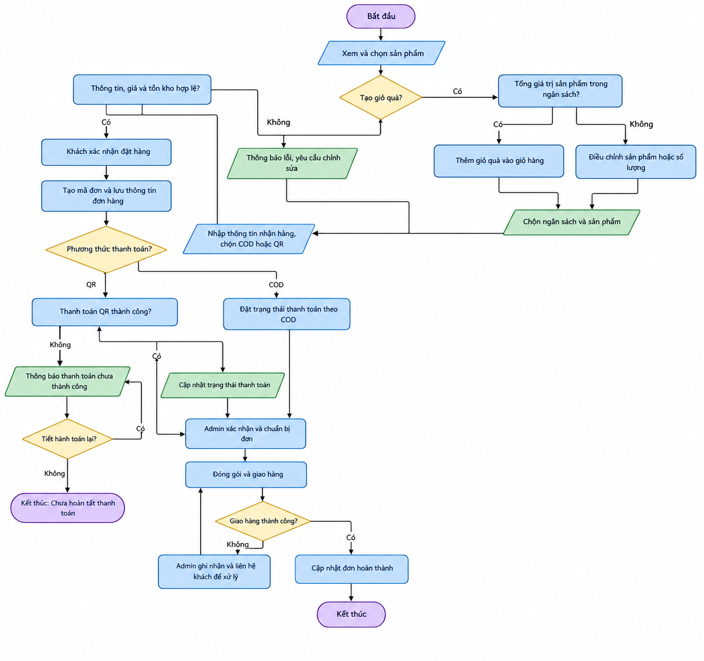

<!DOCTYPE html>
<html lang="vi">
<head>
<meta charset="utf-8">
<meta name="viewport" content="width=device-width, initial-scale=1">
<title>Tài liệu quy trình nghiệp vụ website kinh doanh sản phẩm móc len</title>
</head>
<body style="max-width:980px;margin:0 auto;padding:16px;font-family:system-ui,-apple-system,'Segoe UI',Roboto,Arial,sans-serif;line-height:1.7;color:#27212a;background:#ffffff">

<h1 style="text-align:center;color:#c2457a">Tài liệu quy trình nghiệp vụ website kinh doanh sản phẩm móc len</h1>

<h2 style="color:#c2457a;border-bottom:2px solid #fbe6ef;padding-bottom:4px;margin-top:2em" id="mục-lục">Mục lục</h2>
<ol>
<li><a href="#1-mục-đích-và-phạm-vi">Mục đích và phạm vi</a></li>
<li><a href="#2-tác-nhân-tham-gia">Tác nhân tham gia</a></li>
<li><a href="#3-quy-trình-1-mua-sản-phẩm-làm-sẵn-hoặc-tạo-giỏ-quà-theo-ngân-sách">Quy trình 1: Mua sản phẩm làm sẵn hoặc tạo giỏ quà theo ngân sách</a></li>
<li><a href="#4-quy-trình-2-đặt-làm-theo-mẫucá-nhân-hóa-custom-order">Quy trình 2: Đặt làm theo mẫu/cá nhân hóa (Custom Order)</a></li>
<li><a href="#5-quy-tắc-nghiệp-vụ-dùng-chung">Quy tắc nghiệp vụ dùng chung</a></li>
<li><a href="#6-sơ-đồ-luồng-custom-order">Sơ đồ luồng Custom Order</a></li>
</ol>

<h2 style="color:#c2457a;border-bottom:2px solid #fbe6ef;padding-bottom:4px;margin-top:2em" id="1-mục-đích-và-phạm-vi">1. Mục đích và phạm vi</h2>

Tài liệu mô tả hai quy trình nghiệp vụ chính của website kinh doanh sản phẩm móc len, bao gồm quy trình mua sản phẩm làm sẵn và quy trình đặt làm sản phẩm theo mẫu hoặc yêu cầu cá nhân hóa (Custom Order).

Quy trình mua sản phẩm làm sẵn bao gồm trường hợp khách hàng tạo giỏ quà theo ngân sách. Quy trình Custom Order mô tả các bước từ khi khách gửi yêu cầu, cửa hàng xem xét và báo giá, khách phản hồi, đến khi đơn đặt làm được xác nhận, sản xuất và giao nhận.

Các quy trình được xây dựng dựa trên các chức năng F01 - F09 trong <code>REQUIREMENTS.md</code>.

<h2 style="color:#c2457a;border-bottom:2px solid #fbe6ef;padding-bottom:4px;margin-top:2em" id="2-tác-nhân-tham-gia">2. Tác nhân tham gia</h2>

<table border="1" cellpadding="8" cellspacing="0" style="border-collapse:collapse;width:100%;min-width:560px;border-color:#eadfe4">
<thead>
<tr>
<th align="left" style="background:#f6e9ef">Tác nhân</th>
<th align="left" style="background:#f6e9ef">Vai trò trong quy trình</th>
</tr>
</thead>
<tbody>
<tr>
<td><strong>Guest</strong> (Khách chưa đăng nhập)</td>
<td>Xem, tìm kiếm và lọc sản phẩm; xem chi tiết; có thể tạo giỏ quà theo ngân sách và thao tác giỏ hàng theo phạm vi F02 - F05. Để gửi yêu cầu đặt làm hoặc đặt hàng, khách cần đăng nhập/đăng ký theo F01.</td>
</tr>
<tr>
<td><strong>Customer</strong> (Khách hàng)</td>
<td>Quản lý giỏ hàng, gửi đơn mua sản phẩm làm sẵn, gửi yêu cầu Custom Order, cung cấp thông tin nhận hàng, chấp nhận/từ chối báo giá và theo dõi đơn theo F04 - F08.</td>
</tr>
<tr>
<td><strong>Admin</strong> (Quản trị viên/chủ cửa hàng)</td>
<td>Quản lý sản phẩm và danh mục; xem xét yêu cầu đặt làm, yêu cầu khách bổ sung thông tin, từ chối yêu cầu hoặc lập và gửi báo giá; tiếp nhận, xác nhận và cập nhật trạng thái đơn hàng; xử lý các trường hợp phát sinh liên quan đến đơn hàng và giao nhận; theo dõi thống kê theo phạm vi chức năng F09.</td>
</tr>
<tr>
<td><strong>Hệ thống website</strong></td>
<td>Kiểm tra dữ liệu đầu vào, tính lại giá và tổng tiền phía máy chủ, tạo mã đơn hàng hoặc mã yêu cầu, lưu thông tin và trạng thái, ghi nhận kết quả thanh toán giả lập theo quy trình được triển khai. Hệ thống đồng thời kiểm soát quyền truy cập để khách hàng chỉ xem được lịch sử và thông tin đơn hàng thuộc tài khoản của mình.</td>
</tr>
</tbody>
</table>

<h2 style="color:#c2457a;border-bottom:2px solid #fbe6ef;padding-bottom:4px;margin-top:2em" id="3-quy-trình-1-mua-sản-phẩm-làm-sẵn-hoặc-tạo-giỏ-quà-theo-ngân-sách">3. Quy trình 1: Mua sản phẩm làm sẵn hoặc tạo giỏ quà theo ngân sách</h2>
<h3 id="31-mục-tiêu">3.1. Mục tiêu</h3>

Cho phép khách tìm sản phẩm làm sẵn, hoặc chọn các sản phẩm phù hợp với ngân sách để tạo giỏ quà, kiểm tra đơn hàng và hoàn tất đặt mua qua phương thức thanh toán được website hỗ trợ.

<h3 id="32-dữ-liệu-đầu-vào-và-kết-quả">3.2. Dữ liệu đầu vào và kết quả</h3>
<h4 id="321-dữ-liệu-đầu-vào">3.2.1. Dữ liệu đầu vào</h4>
<ul>
<li>Sản phẩm được chọn, biến thể (nếu có), số lượng.</li>
<li>Nếu tạo giỏ quà: mức ngân sách và danh sách sản phẩm được chọn.</li>
<li>Thông tin người nhận: họ tên, số điện thoại, địa chỉ giao hàng và ghi chú (nếu có).</li>
<li>Phương thức thanh toán: thanh toán khi nhận hàng (COD) hoặc thanh toán QR giả lập, tùy theo các phương thức được website hỗ trợ.</li>
<li>Mã giảm giá (chỉ khi chức năng này được xác nhận trong phạm vi triển khai; không tự giả định là bắt buộc).</li>
</ul>
<h4 id="322-kết-quả-đầu-ra">3.2.2. Kết quả đầu ra</h4>
<ul>
<li>Giỏ hàng có danh sách mặt hàng, số lượng và tổng tiền được hệ thống tính lại.</li>
<li>Đơn hàng có mã đơn, thông tin nhận hàng, phương thức thanh toán và trạng thái xử lý/thanh toán.</li>
<li>Thông tin đơn hàng xuất hiện trong lịch sử của Customer và trang quản trị Admin.</li>
</ul>
<h3 id="33-các-bước-nghiệp-vụ">3.3. Các bước nghiệp vụ</h3>

<table border="1" cellpadding="8" cellspacing="0" style="border-collapse:collapse;width:100%;min-width:560px;border-color:#eadfe4">
<thead>
<tr>
<th align="left" style="background:#f6e9ef">Bước</th>
<th align="left" style="background:#f6e9ef">Tác nhân</th>
<th align="left" style="background:#f6e9ef">Xử lý</th>
<th align="left" style="background:#f6e9ef">Dữ liệu/trạng thái sau bước</th>
</tr>
</thead>
<tbody>
<tr>
<td>1</td>
<td>Guest/Customer</td>
<td>Truy cập website, tìm kiếm hoặc lọc sản phẩm theo từ khóa, danh mục, khoảng giá hoặc màu sắc; xem chi tiết sản phẩm.</td>
<td>Khách chọn được sản phẩm phù hợp; chưa phát sinh đơn hàng.</td>
</tr>
<tr>
<td>2A</td>
<td>Guest/Customer</td>
<td>Đối với sản phẩm làm sẵn, chọn số lượng và thêm sản phẩm vào giỏ hàng.</td>
<td>Giỏ hàng được cập nhật.</td>
</tr>
<tr>
<td>2B</td>
<td>Guest/Customer và Hệ thống</td>
<td>Đối với giỏ quà theo ngân sách, khách chọn mức ngân sách và các sản phẩm mong muốn. Hệ thống tính tổng giá trị các sản phẩm được chọn và kiểm tra điều kiện ngân sách.</td>
<td>Giỏ quà được tạo khi có ít nhất một sản phẩm hợp lệ và tổng giá trị sản phẩm không vượt ngân sách đã chọn. Phí vận chuyển được tính riêng. Nếu giỏ quà chưa có sản phẩm hoặc vượt ngân sách, hệ thống thông báo để khách điều chỉnh trước khi tiếp tục.</td>
</tr>
<tr>
<td>3</td>
<td>Guest/Customer</td>
<td>Xem giỏ hàng, kiểm tra sản phẩm, số lượng và giá; điều chỉnh hoặc xóa sản phẩm nếu cần.</td>
<td>Giỏ hàng được cập nhật theo lựa chọn của khách.</td>
</tr>
<tr>
<td>4</td>
<td>Guest/Customer</td>
<td>Khi tiến hành đặt hàng, khách đăng nhập hoặc đăng ký nếu chưa có phiên đăng nhập; sau đó nhập thông tin người nhận và chọn phương thức thanh toán được hỗ trợ.</td>
<td>Thông tin đặt hàng được gửi đến hệ thống để kiểm tra.</td>
</tr>
<tr>
<td>5</td>
<td>Hệ thống</td>
<td>Kiểm tra thông tin bắt buộc, giá hiện hành, số lượng, tồn kho, phí vận chuyển và tổng tiền ở phía máy chủ.</td>
<td>Nếu hợp lệ, hệ thống hiển thị thông tin đơn hàng để khách kiểm tra và xác nhận. Nếu không hợp lệ, hệ thống thông báo lỗi để khách điều chỉnh.</td>
</tr>
<tr>
<td>6</td>
<td>Customer</td>
<td>Kiểm tra lần cuối thông tin sản phẩm, người nhận, tổng tiền và phương thức thanh toán; xác nhận đặt hàng.</td>
<td>Yêu cầu tạo đơn được gửi đến hệ thống.</td>
</tr>
<tr>
<td>7</td>
<td>Hệ thống</td>
<td>Kiểm tra lại các dữ liệu quan trọng phía máy chủ. Nếu hợp lệ, tạo mã đơn hàng, lưu chi tiết sản phẩm, số lượng, giá tại thời điểm đặt, thông tin nhận hàng và phương thức thanh toán.</td>
<td>Đơn hàng được tạo, lưu trạng thái ban đầu và hiển thị trong lịch sử của khách hàng. Nếu dữ liệu không còn hợp lệ, hệ thống yêu cầu khách điều chỉnh hoặc xác nhận lại.</td>
</tr>
<tr>
<td>8</td>
<td>Admin</td>
<td>Tiếp nhận đơn mới, kiểm tra thông tin và xác nhận đơn hợp lệ. Sau khi xác nhận, cửa hàng tiến hành chuẩn bị sản phẩm.</td>
<td>Đơn hàng được cập nhật từ “Chờ xử lý” sang “Đã xác nhận” và “Đang chuẩn bị” theo tiến trình thực tế.</td>
</tr>
<tr>
<td>9</td>
<td>Admin</td>
<td>Sau khi hoàn tất chuẩn bị sản phẩm, cửa hàng đóng gói và bàn giao đơn cho đơn vị hoặc người thực hiện giao hàng; cập nhật trạng thái theo tiến trình thực tế.</td>
<td>Đơn hàng chuyển sang trạng thái “Đóng gói” và “Giao hàng” tương ứng với các mốc xử lý được ghi nhận.</td>
</tr>
<tr>
<td>10</td>
<td>Admin/Hệ thống</td>
<td>Ghi nhận kết quả giao nhận theo thông tin do cửa hàng tiếp nhận hoặc cập nhật. Chỉ chuyển đơn sang trạng thái hoàn thành khi đáp ứng điều kiện hoàn thành đã quy định.</td>
<td>Nếu giao nhận thành công theo quy ước của website, đơn hàng chuyển sang trạng thái “Hoàn thành”. Nếu giao nhận không thành công, đơn được giữ hoặc cập nhật theo trạng thái xử lý sự cố đã thống nhất; không tự động chuyển sang trạng thái “Hoàn thành”.</td>
</tr>
</tbody>
</table>

<h3 id="34-trạng-thái-và-nhánh-xử-lý">3.4. Trạng thái và nhánh xử lý</h3>

Đối với đơn hàng sản phẩm làm sẵn, trạng thái “Đang móc len” không phù hợp với quy trình thông thường vì sản phẩm đã được hoàn thiện trước khi khách đặt mua. Do đó, các trạng thái xử lý chính của đơn hàng gồm “Chờ xử lý”, “Đã xác nhận”, “Đang chuẩn bị”, “Đóng gói”, “Giao hàng” và “Hoàn thành”. Ngoài ra, trạng thái “Đã hủy” có thể được sử dụng nếu website hỗ trợ và đơn đáp ứng điều kiện hủy theo chính sách đã thống nhất. Trường hợp giao hàng không thành công cần được ghi nhận và xử lý riêng, không mặc nhiên xem là đơn đã hoàn thành.

Các trạng thái được cập nhật theo tiến trình thực tế. Sau khi tiếp nhận đơn, Admin kiểm tra thông tin và xác nhận đơn hợp lệ. Cửa hàng tiếp tục chuẩn bị, đóng gói và bàn giao đơn cho quá trình giao hàng. Khi việc giao nhận kết thúc, đơn được cập nhật thành “Hoàn thành”. Nếu phát sinh sự cố, chẳng hạn khách yêu cầu hủy hoặc giao hàng không thành công, Admin ghi nhận tình trạng và xử lý theo quy tắc đã được nhóm thống nhất.

Bên cạnh trạng thái xử lý đơn hàng, hệ thống cần quản lý trạng thái thanh toán riêng biệt. Việc tách hai loại trạng thái giúp xác định độc lập tiến độ thực hiện đơn và tình trạng thanh toán của khách hàng.

Đối với phương thức thanh toán khi nhận hàng (COD), đơn hàng có thể đang được xử lý hoặc giao hàng trong khi khoản thanh toán chưa được ghi nhận hoàn tất. Đối với phương thức QR giả lập, hệ thống chỉ ghi nhận thanh toán thành công khi có kết quả xác nhận phù hợp với quy trình mô phỏng. Trạng thái “Đã cọc” chỉ sử dụng khi chính sách đặt cọc được nhóm xác nhận áp dụng. Việc cập nhật trạng thái thanh toán không thay thế việc cập nhật trạng thái xử lý đơn hàng. Mỗi trạng thái cần phản ánh đúng tiến trình tương ứng và kết quả được ghi nhận trong website.

<table border="1" cellpadding="8" cellspacing="0" style="border-collapse:collapse;width:100%;min-width:560px;border-color:#eadfe4">
<thead>
<tr>
<th align="left" style="background:#f6e9ef">Trường hợp</th>
<th align="left" style="background:#f6e9ef">Cách xử lý</th>
</tr>
</thead>
<tbody>
<tr>
<td>Giỏ hàng rỗng hoặc thiếu thông tin nhận hàng</td>
<td>Không cho tạo đơn; hiển thị trường cần bổ sung.</td>
</tr>
<tr>
<td>Giá sản phẩm thay đổi, sản phẩm hết hàng hoặc số lượng không hợp lệ</td>
<td>Hệ thống kiểm tra lại dữ liệu phía máy chủ, thông báo thông tin mới và yêu cầu khách điều chỉnh hoặc xác nhận lại trước khi tạo đơn.</td>
</tr>
<tr>
<td>Tổng giá trị sản phẩm trong giỏ quà vượt ngân sách</td>
<td>Thông báo vượt ngân sách và yêu cầu khách điều chỉnh sản phẩm hoặc số lượng.</td>
</tr>
<tr>
<td>Thanh toán QR giả lập thất bại hoặc chưa hoàn tất</td>
<td>Không ghi nhận đã thanh toán; thông báo kết quả và cho phép thử lại nếu quy trình triển khai hỗ trợ.</td>
</tr>
<tr>
<td>Khách yêu cầu hủy đơn</td>
<td>Ghi nhận yêu cầu và xử lý theo trạng thái hiện tại cùng chính sách hủy đã thống nhất. Không tự động hủy đơn đã hoàn thành.</td>
</tr>
<tr>
<td>Giao hàng không thành công</td>
<td>Admin cập nhật tình trạng và liên hệ khách để xử lý thủ công. Tích hợp API vận chuyển tự động nằm ngoài phạm vi nếu nhóm không triển khai chức năng này.</td>
</tr>
</tbody>
</table>

<h3 id="35-sơ-đồ-luồng-đơn-giản">3.5. Sơ đồ luồng đơn giản</h3>

Sơ đồ dưới đây mô tả quy trình mua sản phẩm làm sẵn, bao gồm trường hợp khách tạo giỏ quà theo ngân sách.

<em>Nhấn vào hình để mở ảnh kích thước đầy đủ.</em>

<h2 style="color:#c2457a;border-bottom:2px solid #fbe6ef;padding-bottom:4px;margin-top:2em" id="4-quy-trình-2-đặt-làm-theo-mẫucá-nhân-hóa-custom-order">4. Quy trình 2: Đặt làm theo mẫu/cá nhân hóa (Custom Order)</h2>
<h3 id="41-mục-tiêu">4.1. Mục tiêu</h3>

Quy trình Custom Order nhằm chuẩn hóa việc tiếp nhận và xử lý yêu cầu đặt làm sản phẩm móc len theo mẫu hoặc yêu cầu cá nhân hóa. Cửa hàng xem xét thông tin, đánh giá khả năng thực hiện, gửi báo giá và thời gian dự kiến để khách xác nhận trước khi đơn được chốt và chuyển sang sản xuất. Đối với yêu cầu cần báo giá riêng, thông tin khách gửi ban đầu chưa được xem là giá cuối cùng hoặc cam kết giao hàng chính thức.

<h3 id="42-dữ-liệu-đầu-vào-và-kết-quả">4.2. Dữ liệu đầu vào và kết quả</h3>
<h4 id="421-dữ-liệu-đầu-vào">4.2.1. Dữ liệu đầu vào</h4>
<ul>
<li>Tài khoản Customer đã đăng nhập.</li>
<li>Mẫu gốc trên website hoặc mẫu tham khảo phù hợp với khả năng thực hiện của cửa hàng.</li>
<li>Màu len chọn từ bảng màu có sẵn; kích thước/biến thể theo các tùy chọn mà website hỗ trợ; ghi chú yêu cầu.</li>
<li>Ảnh minh họa (nếu có), ngày mong muốn nhận hàng.</li>
<li>Thông tin báo giá do Admin cung cấp sau khi xem xét yêu cầu, bao gồm mức giá dự kiến, thời gian dự kiến hoàn thành/giao hàng, điều kiện đặt cọc và phương thức thanh toán nếu áp dụng.</li>
</ul>
<h4 id="422-kết-quả-đầu-ra">4.2.2. Kết quả đầu ra</h4>
<ul>
<li>Mã yêu cầu Custom Order và thông tin chi tiết về mẫu, màu sắc, kích thước, ghi chú và các tệp tham khảo hợp lệ.</li>
<li>Kết quả xem xét của Admin: yêu cầu cần bổ sung thông tin, bị từ chối hoặc đủ điều kiện để lập báo giá.</li>
<li>Báo giá kèm giá dự kiến, thời gian hoàn thành/giao hàng và điều kiện thanh toán hoặc đặt cọc nếu áp dụng; kết quả khách chấp nhận hoặc từ chối báo giá.</li>
<li>Đơn đặt làm được chốt khi khách chấp nhận báo giá và đáp ứng các điều kiện xác nhận đã thống nhất.</li>
<li>Thông tin trạng thái sản xuất, giao nhận và thanh toán được lưu theo phạm vi chức năng của website để khách theo dõi.</li>
</ul>
<h3 id="43-các-bước-nghiệp-vụ">4.3. Các bước nghiệp vụ</h3>

Sau bước 4, quy trình được phân thành ba nhánh tùy theo kết quả xem xét của Admin: yêu cầu bổ sung thông tin (bước 5A - 6A), từ chối yêu cầu (bước 5B) hoặc lập báo giá (bước 5C). Chỉ nhánh lập báo giá mới tiếp tục đến bước khách hàng phản hồi báo giá.

<table border="1" cellpadding="8" cellspacing="0" style="border-collapse:collapse;width:100%;min-width:560px;border-color:#eadfe4">
<thead>
<tr>
<th align="left" style="background:#f6e9ef">Bước</th>
<th align="left" style="background:#f6e9ef">Tác nhân</th>
<th align="left" style="background:#f6e9ef">Xử lý</th>
<th align="left" style="background:#f6e9ef">Dữ liệu/trạng thái sau bước</th>
</tr>
</thead>
<tbody>
<tr>
<td>1</td>
<td>Customer</td>
<td>Đăng nhập và mở sản phẩm có nhãn “Nhận đặt làm” hoặc trang đặt làm riêng.</td>
<td>Chọn được mẫu phù hợp.</td>
</tr>
<tr>
<td>2</td>
<td>Customer</td>
<td>Chọn màu len, kích thước hoặc biến thể được hỗ trợ; nhập ghi chú, tải ảnh tham khảo nếu có và cung cấp ngày mong muốn nhận hàng.</td>
<td>Biểu mẫu đặt làm được hoàn thiện.</td>
</tr>
<tr>
<td>3</td>
<td>Hệ thống</td>
<td>Kiểm tra các trường bắt buộc và tệp đính kèm theo quy tắc của website; tạo mã yêu cầu và lưu thông tin hợp lệ.</td>
<td>Yêu cầu được tiếp nhận với trạng thái “Chờ cửa hàng xem xét”.</td>
</tr>
<tr>
<td>4</td>
<td>Admin</td>
<td>Kiểm tra mẫu, màu sắc, kích thước, ghi chú, ảnh tham khảo và ngày khách mong muốn nhận hàng; đánh giá khả năng thực hiện.</td>
<td>Yêu cầu được phân loại thành cần bổ sung thông tin, bị từ chối hoặc có thể báo giá.</td>
</tr>
<tr>
<td>5A</td>
<td>Admin</td>
<td>Nếu thông tin chưa đủ, ghi rõ nội dung cần bổ sung và gửi thông báo cho khách.</td>
<td>Trạng thái “Cần bổ sung thông tin”.</td>
</tr>
<tr>
<td>6A</td>
<td>Customer</td>
<td>Bổ sung hoặc chỉnh sửa thông tin theo yêu cầu của Admin.</td>
<td>Yêu cầu được cập nhật và quay lại trạng thái “Chờ cửa hàng xem xét”.</td>
</tr>
<tr>
<td>5B</td>
<td>Admin</td>
<td>Nếu cửa hàng không thể thực hiện, ghi lý do và thông báo từ chối yêu cầu.</td>
<td>Trạng thái “Bị từ chối”; kết thúc quy trình, không phát sinh sản xuất.</td>
</tr>
<tr>
<td>5C</td>
<td>Admin</td>
<td>Nếu có thể thực hiện, lập báo giá, thời gian dự kiến hoàn thành/giao hàng và điều kiện thanh toán hoặc đặt cọc nếu áp dụng; gửi cho khách.</td>
<td>Trạng thái “Chờ khách phản hồi báo giá”.</td>
</tr>
<tr>
<td>7</td>
<td>Customer</td>
<td>Xem lại nội dung yêu cầu, giá, thời gian dự kiến và điều kiện thanh toán; lựa chọn chấp nhận hoặc từ chối báo giá.</td>
<td>Nếu khách từ chối, hệ thống ghi nhận trạng thái “Báo giá bị từ chối” và kết thúc quy trình. Nếu khách chấp nhận, quy trình chuyển sang bước đáp ứng điều kiện chốt đơn; thực hiện thanh toán hoặc đặt cọc trước nếu báo giá có quy định.</td>
</tr>
<tr>
<td>8</td>
<td>Customer/Hệ thống</td>
<td>Khách thực hiện thanh toán hoặc đặt cọc nếu đây là điều kiện đã được thống nhất trong báo giá. Hệ thống ghi nhận kết quả theo phương thức thanh toán giả lập.</td>
<td>Nếu điều kiện thanh toán được áp dụng và giao dịch thành công, hệ thống cập nhật trạng thái thanh toán tương ứng. Nếu giao dịch thất bại, đơn tiếp tục ở trạng thái chờ thanh toán/đặt cọc hoặc ghi nhận thanh toán thất bại; chưa chuyển sang sản xuất khi điều kiện thanh toán chưa được đáp ứng.</td>
</tr>
<tr>
<td>9</td>
<td>Hệ thống/Admin</td>
<td>Kiểm tra việc khách chấp nhận báo giá và xác nhận các điều kiện chốt đơn đã được đáp ứng. Nếu báo giá yêu cầu thanh toán hoặc đặt cọc trước, chỉ xác nhận đơn đủ điều kiện chốt sau khi hệ thống ghi nhận kết quả thanh toán đáp ứng yêu cầu.</td>
<td>Khi các điều kiện chốt đơn đã được đáp ứng, hệ thống lưu giá cuối cùng, nội dung yêu cầu đã xác nhận và thời gian dự kiến hoàn thành/giao hàng; đơn chuyển sang trạng thái “Chờ sản xuất”. Nếu điều kiện thanh toán trước chưa được đáp ứng, đơn tiếp tục ở trạng thái “Chờ thanh toán/đặt cọc” và chưa chuyển sang sản xuất.</td>
</tr>
<tr>
<td>10</td>
<td>Admin/Hệ thống</td>
<td>Tiến hành móc len theo mẫu, màu sắc, kích thước và các yêu cầu đã được khách xác nhận; cập nhật tiến độ thực hiện theo quy trình của cửa hàng.</td>
<td>Đơn chuyển từ “Chờ sản xuất” sang “Đang móc len”. Khi sản phẩm hoàn thành, đơn đủ điều kiện chuyển sang công đoạn đóng gói.</td>
</tr>
<tr>
<td>11</td>
<td>Admin/Hệ thống</td>
<td>Sau khi sản phẩm hoàn thành, cửa hàng đóng gói, bàn giao đơn cho quá trình giao hàng và cập nhật trạng thái theo tiến trình thực tế. Ghi nhận kết quả giao nhận theo quy ước của website.</td>
<td>Đơn lần lượt được ghi nhận ở trạng thái “Đóng gói”, “Giao hàng” và “Hoàn thành” khi đáp ứng điều kiện tương ứng. Nếu giao hàng không thành công, đơn được xử lý theo quy trình ngoại lệ, không tự động chuyển sang “Hoàn thành”.</td>
</tr>
<tr>
<td>12</td>
<td>Customer</td>
<td>Truy cập tài khoản để xem thông tin và tiến độ đơn đặt làm.</td>
<td>Khách theo dõi được trạng thái xử lý và kết quả giao nhận.</td>
</tr>
</tbody>
</table>

<h3 id="44-trạng-thái-nghiệp-vụ-đề-xuất">4.4. Trạng thái nghiệp vụ đề xuất</h3>
<h4 id="441-trạng-thái-yêu-cầu-và-báo-giá">4.4.1. Trạng thái yêu cầu và báo giá</h4>

<table border="1" cellpadding="8" cellspacing="0" style="border-collapse:collapse;width:100%;min-width:560px;border-color:#eadfe4">
<thead>
<tr>
<th align="left" style="background:#f6e9ef">Trạng thái</th>
<th align="left" style="background:#f6e9ef">Ý nghĩa</th>
</tr>
</thead>
<tbody>
<tr>
<td>Chờ cửa hàng xem xét</td>
<td>Yêu cầu đã được tiếp nhận và chờ Admin đánh giá.</td>
</tr>
<tr>
<td>Cần bổ sung thông tin</td>
<td>Admin yêu cầu khách cung cấp hoặc chỉnh sửa thông tin.</td>
</tr>
<tr>
<td>Chờ khách phản hồi báo giá</td>
<td>Báo giá đã được gửi và đang chờ khách quyết định.</td>
</tr>
<tr>
<td>Báo giá bị từ chối</td>
<td>Khách không chấp nhận báo giá; quy trình kết thúc.</td>
</tr>
<tr>
<td>Bị từ chối</td>
<td>Cửa hàng không thể thực hiện yêu cầu; quy trình kết thúc.</td>
</tr>
</tbody>
</table>

Khi khách bổ sung thông tin theo yêu cầu của Admin, hệ thống cập nhật nội dung trên yêu cầu hiện có và chuyển trạng thái về “Chờ cửa hàng xem xét”. Việc bổ sung thông tin không làm phát sinh yêu cầu mới, trừ khi khách chủ động gửi một yêu cầu đặt làm khác.

<h4 id="442-trạng-thái-đơn-đặt-làm">4.4.2. Trạng thái đơn đặt làm</h4>

<table border="1" cellpadding="8" cellspacing="0" style="border-collapse:collapse;width:100%;min-width:560px;border-color:#eadfe4">
<thead>
<tr>
<th align="left" style="background:#f6e9ef">Trạng thái</th>
<th align="left" style="background:#f6e9ef">Ý nghĩa</th>
</tr>
</thead>
<tbody>
<tr>
<td>Chờ thanh toán/đặt cọc</td>
<td>Chỉ áp dụng khi báo giá đã được chấp nhận nhưng điều kiện thanh toán tương ứng chưa hoàn tất.</td>
</tr>
<tr>
<td>Chờ sản xuất</td>
<td>Báo giá đã được chấp nhận và các điều kiện cần thiết để chốt đơn đã đáp ứng.</td>
</tr>
<tr>
<td>Đang móc len</td>
<td>Cửa hàng đang thực hiện sản phẩm theo yêu cầu đã xác nhận.</td>
</tr>
<tr>
<td>Đóng gói</td>
<td>Sản phẩm đã hoàn thành công đoạn sản xuất và đang được đóng gói.</td>
</tr>
<tr>
<td>Giao hàng</td>
<td>Đơn đã được bàn giao cho quá trình giao nhận.</td>
</tr>
<tr>
<td>Hoàn thành</td>
<td>Việc giao nhận đã kết thúc theo quy ước của website.</td>
</tr>
<tr>
<td>Đã hủy</td>
<td>Trạng thái “Đã hủy” chỉ được cập nhật khi yêu cầu hủy được chấp thuận theo chính sách của cửa hàng. Đối với đơn đã bắt đầu sản xuất, Admin xem xét yêu cầu theo điều kiện đã thống nhất và thông báo kết quả cho khách. Việc chấp thuận hủy không đồng nghĩa với việc tự động hoàn tiền hoặc hoàn lại khoản đặt cọc.</td>
</tr>
</tbody>
</table>

Trạng thái “Chờ thanh toán/đặt cọc” chỉ được sử dụng khi khách đã chấp nhận báo giá nhưng chưa hoàn tất điều kiện thanh toán trước đã được thống nhất. Nếu báo giá không yêu cầu thanh toán trước, đơn có thể chuyển sang “Chờ sản xuất” sau khi khách chấp nhận báo giá và đáp ứng các điều kiện chốt đơn khác.

<h4 id="443-trạng-thái-thanh-toán">4.4.3. Trạng thái thanh toán</h4>

<table border="1" cellpadding="8" cellspacing="0" style="border-collapse:collapse;width:100%;min-width:560px;border-color:#eadfe4">
<thead>
<tr>
<th align="left" style="background:#f6e9ef">Trạng thái thanh toán</th>
<th align="left" style="background:#f6e9ef">Ý nghĩa</th>
</tr>
</thead>
<tbody>
<tr>
<td>Chưa thanh toán</td>
<td>Chưa ghi nhận khoản thanh toán thành công cho đơn hàng.</td>
</tr>
<tr>
<td>Thanh toán thất bại</td>
<td>Giao dịch thanh toán giả lập được ghi nhận thất bại.</td>
</tr>
<tr>
<td>Đã cọc</td>
<td>Đã ghi nhận khoản đặt cọc theo điều kiện được thống nhất; chưa thanh toán đủ giá trị phải thanh toán.</td>
</tr>
<tr>
<td>Đã thanh toán đủ</td>
<td>Đã ghi nhận hoàn tất nghĩa vụ thanh toán theo điều kiện áp dụng cho đơn hàng.</td>
</tr>
</tbody>
</table>

Hệ thống chỉ cập nhật trạng thái thanh toán theo kết quả giao dịch được ghi nhận và điều kiện thanh toán áp dụng cho đơn hàng. Không ghi nhận thanh toán thành công khi khách mới bắt đầu thao tác hoặc giao dịch chưa có kết quả thành công.

Trạng thái thanh toán được cập nhật độc lập với trạng thái đơn đặt làm. Ví dụ, khi cửa hàng đã nhận khoản đặt cọc nhưng chưa nhận đủ tiền, trạng thái thanh toán có thể là “Đã cọc” trong khi trạng thái đơn là “Đang móc len”. Khi khoản thanh toán đầy đủ được ghi nhận, trạng thái thanh toán chuyển sang “Đã thanh toán đủ”.

<h3 id="45-các-trường-hợp-ngoại-lệ">4.5. Các trường hợp ngoại lệ</h3>

<table border="1" cellpadding="8" cellspacing="0" style="border-collapse:collapse;width:100%;min-width:560px;border-color:#eadfe4">
<thead>
<tr>
<th align="left" style="background:#f6e9ef">Trường hợp</th>
<th align="left" style="background:#f6e9ef">Cách xử lý</th>
</tr>
</thead>
<tbody>
<tr>
<td>Khách chưa đăng nhập</td>
<td>Yêu cầu đăng nhập/đăng ký trước khi gửi Custom Order (F01, F06).</td>
</tr>
<tr>
<td>Thiếu màu, kích thước hoặc thông tin cần thiết</td>
<td>Không tiếp nhận yêu cầu thiếu trường bắt buộc; nếu thông tin chưa đủ để đánh giá sau khi tiếp nhận, Admin chuyển sang “Cần bổ sung thông tin”.</td>
</tr>
<tr>
<td>Tệp ảnh không hợp lệ hoặc tải lên thất bại</td>
<td>Hiển thị lỗi; không lưu tệp không đáp ứng quy tắc kiểm tra định dạng/dung lượng. Khách có thể tải lại hoặc gửi yêu cầu không kèm ảnh nếu ảnh không bắt buộc.</td>
</tr>
<tr>
<td>Cửa hàng không thể thực hiện</td>
<td>Admin từ chối, lưu lý do và thông báo cho khách; không tạo bước đặt cọc hoặc sản xuất.</td>
</tr>
<tr>
<td>Khách từ chối báo giá</td>
<td>Ghi nhận “Báo giá bị từ chối”; không sản xuất.</td>
</tr>
<tr>
<td>Khách không phản hồi báo giá</td>
<td>Giữ yêu cầu ở trạng thái “Chờ khách phản hồi báo giá” cho đến khi khách phản hồi hoặc yêu cầu được xử lý theo thời hạn do nhóm thống nhất. Nếu chưa triển khai cơ chế tự động hủy, Admin thực hiện xử lý thủ công. Không xem việc khách không phản hồi là đồng ý báo giá.</td>
</tr>
<tr>
<td>Khách chấp nhận báo giá nhưng thanh toán/đặt cọc thất bại</td>
<td>Nếu báo giá yêu cầu thanh toán hoặc đặt cọc trước, đơn tiếp tục ở trạng thái “Chờ thanh toán/đặt cọc” hoặc ghi nhận “Thanh toán thất bại”; chưa chuyển sang sản xuất cho đến khi điều kiện thanh toán được đáp ứng. Cho phép thử lại nếu quy trình thanh toán giả lập hỗ trợ. Nếu báo giá không yêu cầu thanh toán trước, xử lý đơn theo các điều kiện chốt đơn đã thống nhất.</td>
</tr>
<tr>
<td>Khách yêu cầu hủy trước khi bắt đầu sản xuất</td>
<td>Ghi nhận yêu cầu và để Admin xác nhận hủy theo quy tắc đã thống nhất; cập nhật trạng thái “Đã hủy” nếu được chấp nhận.</td>
</tr>
<tr>
<td>Khách yêu cầu hủy sau khi đã bắt đầu móc len</td>
<td>Admin xem xét yêu cầu theo chính sách của cửa hàng và thông báo kết quả cho khách. Việc chấp nhận hủy không đồng nghĩa với việc tự động hoàn tiền hoặc hoàn cọc. Điều kiện hủy, hoàn tiền và xử lý khoản đặt cọc cần được nhóm thống nhất trước khi triển khai.</td>
</tr>
<tr>
<td>Báo giá hoặc thời hạn thay đổi</td>
<td>Không âm thầm ghi đè nội dung khách đã chấp nhận. Admin gửi thông tin cập nhật để khách xác nhận lại trước khi tiếp tục nếu thay đổi ảnh hưởng đến giá hoặc cam kết nhận hàng.</td>
</tr>
<tr>
<td>Giao hàng chậm hoặc không thành công</td>
<td>Admin ghi nhận tình trạng giao hàng và phối hợp với khách để xử lý thủ công. Nếu website chưa tích hợp API của đơn vị vận chuyển, trạng thái giao nhận được cập nhật theo thông tin mà cửa hàng tiếp nhận; thời gian vận chuyển chỉ mang tính dự kiến.</td>
</tr>
</tbody>
</table>

<h2 style="color:#c2457a;border-bottom:2px solid #fbe6ef;padding-bottom:4px;margin-top:2em" id="5-quy-tắc-nghiệp-vụ-dùng-chung">5. Quy tắc nghiệp vụ dùng chung</h2>
<ul>
<li><strong>Tính giá:</strong> Trước khi tạo đơn hàng, hệ thống kiểm tra lại giá sản phẩm, số lượng, tồn kho, phí vận chuyển và tổng tiền dựa trên dữ liệu hợp lệ tại thời điểm đặt hàng. Nếu thông tin thay đổi hoặc không còn hợp lệ, hệ thống thông báo để khách điều chỉnh hoặc xác nhận lại trước khi tiếp tục.</li>
<li><strong>Ngân sách giỏ quà:</strong> Mức ngân sách áp dụng cho tổng giá trị các sản phẩm trong giỏ quà; phí vận chuyển được tính riêng. Nếu vượt ngân sách, khách phải điều chỉnh giỏ quà trước khi chuyển sang giỏ hàng.</li>
<li><strong>Báo giá Custom Order:</strong> Yêu cầu gửi từ biểu mẫu chưa phải là đơn sản xuất đã xác nhận. Đối với yêu cầu cần báo giá riêng, đơn chỉ được chốt sau khi Admin gửi báo giá, khách hàng chấp nhận và đáp ứng các điều kiện chốt đơn đã thống nhất. Điều kiện thanh toán hoặc đặt cọc chỉ áp dụng khi được quy định trong báo giá hoặc chính sách của cửa hàng.</li>
<li><strong>Tách trạng thái:</strong> Trạng thái xử lý đơn/sản xuất và trạng thái thanh toán phải là hai thông tin riêng. Ví dụ, đơn có thể đang “Đang móc len” và đồng thời có trạng thái thanh toán “Đã cọc”.</li>
<li><strong>Quyền truy cập:</strong> Customer chỉ xem được yêu cầu và đơn của chính mình; Admin mới có quyền xử lý yêu cầu, báo giá và cập nhật trạng thái quản trị.</li>
<li><strong>Theo dõi:</strong> Website cần hiển thị trạng thái hiện tại của đơn hàng và yêu cầu đặt làm để khách theo dõi. Việc lưu lịch sử thay đổi trạng thái được thực hiện theo phạm vi chức năng mà nhóm xác định và triển khai.</li>
<li><strong>Thanh toán và vận chuyển:</strong> Trong phạm vi đồ án, các phương thức COD và QR chỉ được mô tả theo cách thức triển khai thực tế của website. Nếu thanh toán QR chỉ là mô phỏng, cần ghi rõ đây là thanh toán QR giả lập, không phải tích hợp thanh toán ngân hàng thật. Tương tự, nếu website chưa tích hợp API của đơn vị vận chuyển, trạng thái giao nhận được cập nhật theo thông tin do cửa hàng ghi nhận, không mô tả như quy trình vận chuyển tự động.</li>
</ul>

<h2 style="color:#c2457a;border-bottom:2px solid #fbe6ef;padding-bottom:4px;margin-top:2em" id="6-sơ-đồ-luồng-custom-order">6. Sơ đồ luồng Custom Order</h2>

Sơ đồ mô tả đầy đủ các bước từ lúc khách gửi yêu cầu đặt làm đến khi sản phẩm được giao. Các nhánh bổ sung thông tin, cửa hàng từ chối, khách không chấp nhận báo giá, thanh toán thất bại, yêu cầu hủy và giao hàng không thành công được thể hiện riêng để tránh nhầm lẫn với luồng xử lý thành công.

<em>Nhấn vào hình để mở ảnh kích thước đầy đủ.</em>

<small>Tài liệu quy trình nghiệp vụ · các chức năng F01 - F09 theo REQUIREMENTS.md</small>

</body>
</html>
