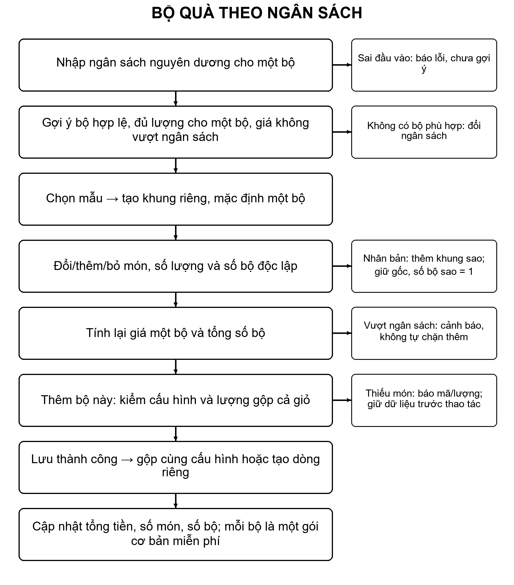
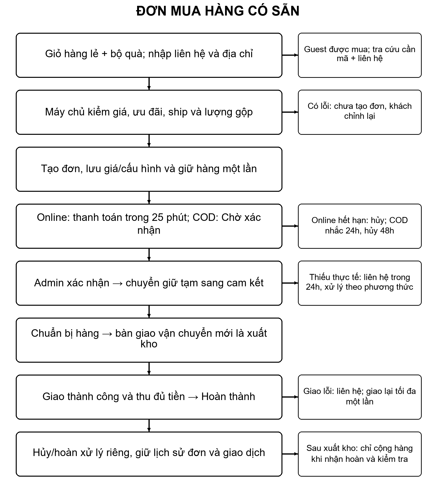
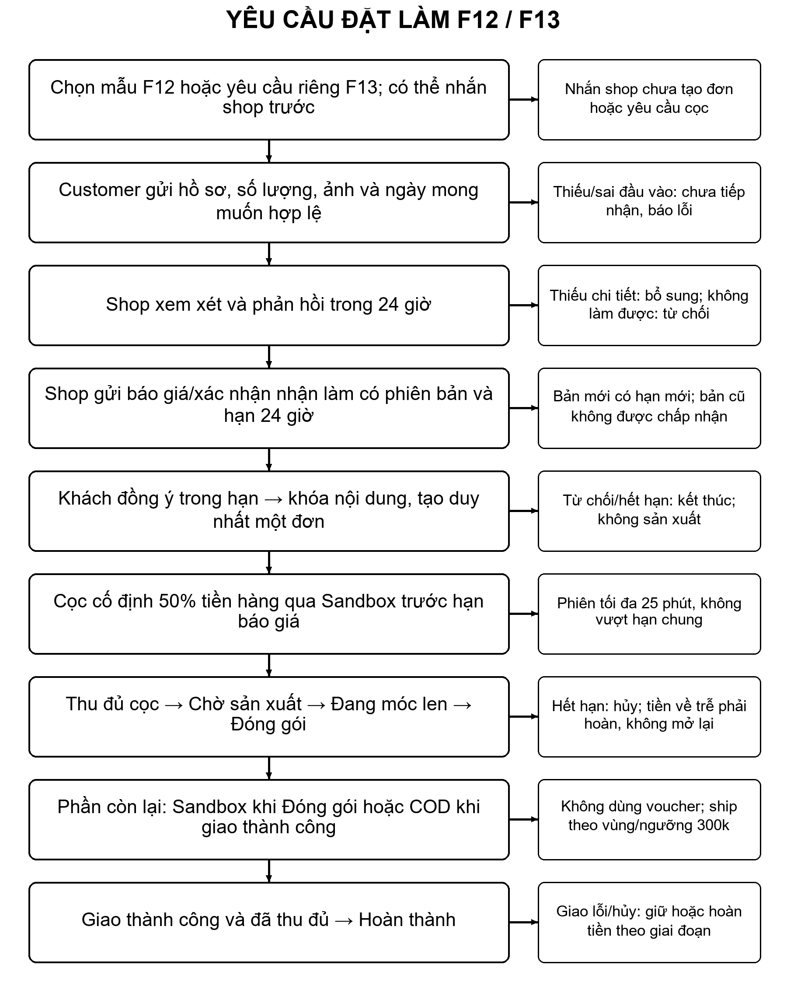
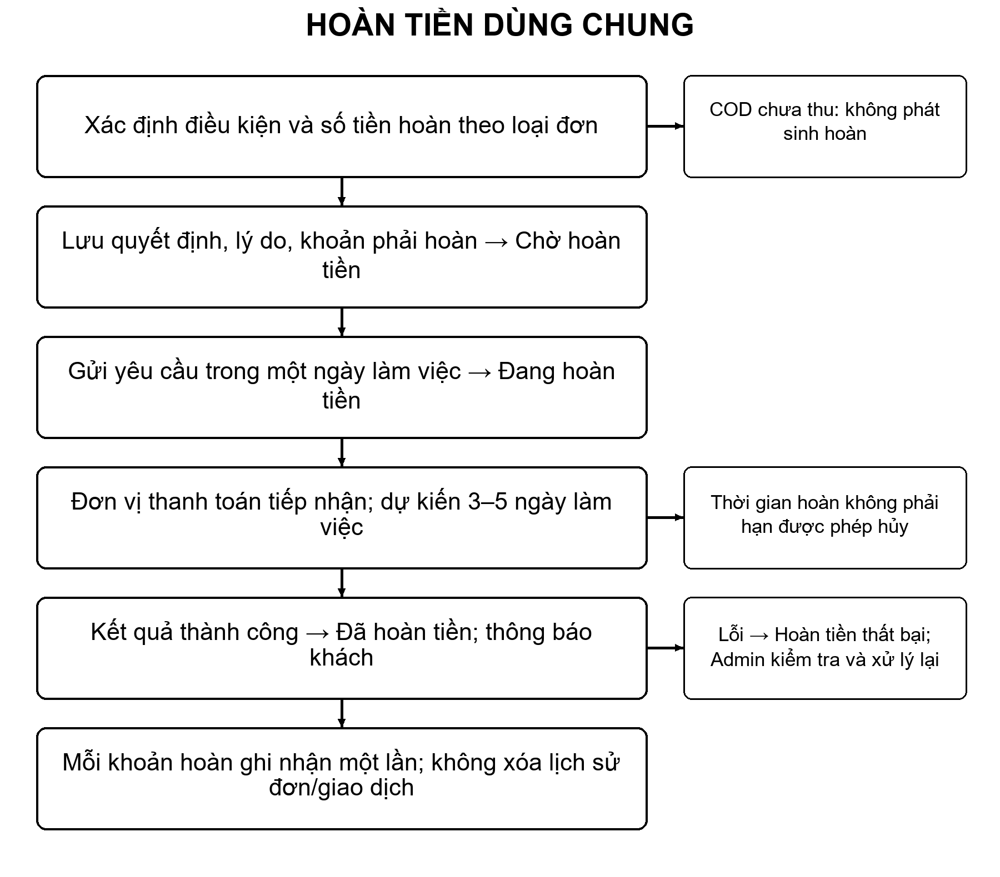

# Quy tắc nghiệp vụ tổng hợp DA02.4

## 1. Phạm vi và cách áp dụng

Bài này thống nhất toàn bộ quy tắc bộ quà, mua hàng có sẵn và đặt làm từ DA02.1, bản Done DA02.2 và DA02.3. Các nội dung trùng được trình bày chung theo nghiệp vụ; những điều kiện, ngoại lệ, công thức và trường hợp đối chiếu riêng được giữ lại. Các quyết định bổ sung đã chốt được áp dụng trực tiếp trong từng phần.

### 1.1. Phân biệt ba hình thức mua hàng

| Hình thức | Điều kiện và thao tác | Thanh toán |
| --- | --- | --- |
| Hàng có sẵn | Còn đúng mẫu/màu/kích thước và đủ lượng có thể bán; thêm giỏ, checkout bình thường. | Không yêu cầu cọc riêng; online Sandbox hoặc COD theo điều kiện giao hàng. |
| Bộ quà | Chọn và tùy chỉnh từ hàng có sẵn; shop trang trí, gói hoàn chỉnh từng bộ. | Theo đơn mua sẵn; gói quà cơ bản không thu phí riêng, không phát sinh cọc. |
| Đặt làm F12/F13 | Phải sản xuất mới theo mẫu shop hoặc yêu cầu riêng; shop xác nhận khả năng làm, giá và thời gian, khách đồng ý. | Tất cả đơn đặt làm cọc cố định 50% tiền hàng trước sản xuất; không gồm ship. |

Hết hàng thì có điểm liên hệ “Nhắn shop đặt làm” kèm tên/mã mẫu. Khách trao đổi với shop trước; bấm liên hệ chưa tạo đơn, chưa phải gửi yêu cầu đặt làm và chưa phát sinh cọc. Shop không nhận làm hoặc khách không đồng ý thì kết thúc. Trao đổi qua kênh liên hệ không thay thế hồ sơ yêu cầu, báo giá và giao dịch cần lưu trên hệ thống; phạm vi hiện tại không bổ sung hệ thống live chat thời gian thực.

### 1.2. Người mua và trách nhiệm xử lý

| Vai trò | Phạm vi |
| --- | --- |
| Guest | Xem/chọn sản phẩm, tạo bộ quà, quản lý giỏ và mua hàng có sẵn bằng thông tin liên hệ/nhận hàng đầy đủ. Tra cứu đơn bằng mã đơn kèm email hoặc số điện thoại; không xem lịch sử tài khoản. |
| Customer | Các chức năng mua hàng; gửi yêu cầu đặt làm F12/F13 chính thức sau đăng nhập; chỉ xem/thao tác hồ sơ, yêu cầu, báo giá và đơn của chính mình. |
| Admin | Kiểm tra, xác nhận/từ chối, xử lý thiếu hàng, báo giá, sản xuất, giao nhận, hủy/hoàn và theo dõi giao dịch trong phạm vi quyền; lưu thời gian, lý do và người thực hiện. |

Đơn đặt làm tách khỏi lần checkout mua hàng có sẵn/bộ quà. Nhắn shop trước chưa phải yêu cầu đăng nhập để gửi hồ sơ; trước lúc gửi yêu cầu F12/F13 chính thức, khách phải đăng nhập Customer.

### 1.3. Phạm vi đã chạy và phạm vi triển khai tiếp

DA02.1 đối chiếu frontend tại commit 4f93ac9: tám sản phẩm, ba bộ quà mẫu, nhiều khung soạn, giỏ hàng và localStorage/stockDemo. DA01 đã merge qua PR #43, cung cấp nền Express và các đường dẫn kiểm tra máy chủ/database. Các quy tắc checkout, đơn hàng, giữ tồn, thanh toán, đặt làm và hoàn tiền dưới đây là đầu vào triển khai backend; chưa xác nhận các chức năng này đã chạy trên website.

## 2. Quy tắc bộ quà

### 2.1. Ngân sách và cách tính tiền

Ngân sách phải là số nguyên dương theo VNĐ và áp dụng cho tiền sản phẩm của một bộ. Gói quà cơ bản không thu phí riêng, kể cả khi khách đổi món, tăng số lượng món hoặc tăng số bộ. Tiền hàng vẫn được tính theo sản phẩm và số lượng thực tế. Phí vận chuyển và voucher được tính tại checkout theo mục 3 của bài này; frontend đang đối chiếu chưa xử lý các khoản này.

Giá một bộ = tổng (giá hiện hành của mỗi sản phẩm × số lượng sản phẩm trong một bộ). Thành tiền = giá một bộ × số bộ muốn mua. Giá lấy từ catalog chung, không lấy tổng tiền do giao diện/bản lưu cung cấp.

Ví dụ: GIFT-01 “Món quà nhỏ” gồm KC-001 giá 45.000đ và HL-001 giá 35.000đ: một bộ 80.000đ, hai bộ 160.000đ. Với ngân sách 100.000đ, tiền dư của một bộ là 20.000đ.

### 2.2. Điều kiện gợi ý bộ quà

Chỉ lấy bộ mẫu không rỗng, có mã sản phẩm hợp lệ, giá một bộ không vượt ngân sách và đủ stockDemo cho một bộ. Nếu cùng mã xuất hiện nhiều lần thì cộng lượng trước khi kiểm tra. Kết quả sắp giá tăng dần; cùng giá thì sắp theo mã bộ.

Ngân sách không hợp lệ: hàm gợi ý trả mảng rỗng, giao diện báo lỗi nhập. Ngân sách hợp lệ nhưng không có bộ phù hợp: thông báo để khách đổi ngân sách. Không tự tăng ngân sách hoặc tự bỏ món của bộ mẫu.

### 2.3. Tùy chỉnh và số bộ

Khách chọn được nhiều mẫu; mỗi lần chọn tạo một khung riêng ở Bước 3 – Tùy chỉnh bộ quà trên trang Chọn quà, mặc định một bộ. Mỗi khung chỉnh ngân sách, sản phẩm, số lượng món và số bộ độc lập.

Chỉ đổi/thêm sản phẩm trong allowedProductIds của bộ mẫu; được bỏ món. Số lượng món và số bộ phải là số nguyên dương. Muốn bỏ món phải dùng nút Bỏ sản phẩm, không nhập số lượng 0. Bộ đang soạn được rỗng nhưng không thể thêm giỏ khi chưa có món.

### 2.4. Cảnh báo vượt ngân sách

Điều kiện không vượt ngân sách dùng khi gợi ý bộ ban đầu. Sau khi khách chỉnh, nếu giá một bộ vượt ngân sách thì hiển thị phần vượt; vẫn cho thêm giỏ nếu bộ hợp lệ, đủ lượng và lưu thành công.

Ví dụ: GIFT-01 đổi thành hai KC-001 và một HL-001 có giá 125.000đ, vượt ngân sách 100.000đ là 25.000đ. Giỏ hiện tại vẫn nhận cấu hình này nếu đủ stockDemo.

### 2.5. Nhân bản để chỉnh riêng

Nút Nhân bản bộ này tạo một khung mới ngay dưới bộ gốc, sao chép độc lập danh sách món và giữ ngân sách. Bản sao luôn mặc định một bộ; sửa bản sao không thay đổi bộ gốc. Một khung đang chọn hai bộ khi nhân bản vẫn chỉ tạo một khung sao với số bộ là 1.

Nhân bản không tự thêm giỏ và không giảm số bộ gốc. Từ trang giỏ, Nhân bản để chỉnh riêng tạo bản soạn mới rồi chuyển về trang chọn quà; dòng gốc trong giỏ và các khung đang soạn được giữ.

### 2.6. Thêm giỏ và gộp cấu hình

Ở Bước 4 – Tổng kết bộ quà, mỗi bộ đang soạn có nút Thêm bộ này vào giỏ riêng. Cấu hình được nhận diện bằng mã sản phẩm và tổng số lượng từng mã trong một bộ, không phụ thuộc thứ tự món, tên bộ, mã bộ mẫu hay ngân sách.

Cùng cấu hình thì tăng số bộ trên dòng cũ; khác thành phần hoặc khác số lượng món trong một bộ thì tạo dòng riêng. Tên và ngân sách của dòng cũ được giữ khi gộp. Muốn bản sao thành dòng riêng phải đổi cấu hình, không chỉ đổi tên.

Thêm thành công không xóa khung đang soạn; bấm thêm lần nữa tiếp tục tăng số bộ trong giỏ. Chỉnh khung sau đó không tự cập nhật bộ đã thêm vào giỏ.

### 2.7. Kiểm tra lượng gộp

Lượng cần của một mã = lượng mua lẻ + tổng (số món đó trong một bộ × số bộ) ở tất cả dòng bộ quà. Kiểm tra lại cả giỏ sau thao tác thêm hoặc đổi số lượng.

Ví dụ: stockDemo của KC-001 là 20. Đã mua lẻ 18 và thêm hai bộ GIFT-01 thì tổng cần là 20, được chấp nhận. Thêm một bộ nữa làm tổng cần 21 thì trả OUT_OF_STOCK và giữ giỏ cũ, không thêm một phần bộ.

Gợi ý chỉ kiểm lượng cho một bộ mẫu; khung đang soạn chưa giữ chỗ tồn kho. Kiểm tra giỏ dựa trên stockDemo và không trừ trực tiếp số này trong catalog.

### 2.8. Lưu trữ và số đếm giỏ

Giỏ và danh sách khung được lưu ở các khóa localStorage riêng, dùng chung trong cùng origin. Khác host/cổng hoặc chuyển giữa localhost và GitHub Pages sẽ không dùng chung vùng lưu.

Chỉ cập nhật trạng thái giỏ/workspace sau khi lưu thành công. Nếu lỗi dung lượng hoặc quyền lưu trữ, báo lỗi và giữ dữ liệu trước thao tác. Sau thao tác giỏ thành công, tính lại tổng tiền, tổng số món, số bộ và số đếm trên biểu tượng giỏ. Biểu tượng đếm số món thực tế, không chỉ đếm số dòng hay số bộ.

### 2.9. Đóng gói và trang trí

Shop sắp xếp, trang trí và gói bộ quà hoàn chỉnh để khách có thể đem tặng sau khi nhận. Gói quà cơ bản đi kèm mỗi bộ, không thu phí riêng.

Quy tắc không thu phí gói cơ bản áp dụng khi chọn nguyên bộ mẫu, đổi/thêm/bỏ món, tăng số lượng món trong bộ hoặc tăng số bộ. Tiền hàng thay đổi theo sản phẩm và số lượng thực tế; phí vận chuyển được tính riêng theo quy tắc mua hàng.

Mỗi bộ được gói riêng: chọn hai bộ thì shop chuẩn bị hai gói quà hoàn chỉnh, dù hai bộ cùng cấu hình và được gộp trên một dòng giỏ. Tăng số lượng một món bên trong một bộ chỉ thay đổi thành phần của bộ đó, không tự tạo thêm gói quà.

Phiên bản đầu dùng kiểu gói quà cơ bản của shop; chưa hỗ trợ mua riêng hoặc tự cấu hình hộp, nơ, giấy gói để khách tự trang trí.

### 2.10. Phân luồng bộ quà và đặt làm

Bộ quà được chọn từ sản phẩm có sẵn, kể cả khi khách đổi món hoặc tăng/giảm số lượng, đi theo luồng mua hàng thông thường ở mục 3–4 và không yêu cầu đặt cọc riêng. Việc shop trang trí, gói quà không tự biến đơn mua sẵn thành đơn đặt làm. Phí vận chuyển, voucher, phương thức thanh toán và điều kiện hủy/hoàn tiền áp dụng theo quy tắc mua hàng được thống nhất trong bài này.

Nếu yêu cầu phải sản xuất riêng, như đặt theo mẫu với màu/kích thước cần làm mới hoặc đặt theo ảnh, thêu tên, yêu cầu riêng, thì xử lý theo mục 5. Tất cả đơn đặt làm phải thanh toán đủ tiền cọc theo giá và điều kiện đã xác nhận trước khi bắt đầu sản xuất; không gộp chung lần checkout với hàng mua sẵn/bộ quà có sẵn.

Các quy tắc đóng gói và phân luồng thanh toán trên là quyết định nghiệp vụ bổ sung của nhóm; checkout, đặt cọc và xử lý đơn hàng tại backend chưa được triển khai trong bản frontend đang đối chiếu.

### 2.11. Quy tắc bộ quà khi chuyển sang backend

Giữ các quy tắc hiện hành về ngân sách một bộ, bản sao độc lập, gộp cấu hình và lượng gộp. Backend phải lấy giá/tồn từ PostgreSQL, kiểm tra lại dữ liệu gửi lên và điều kiện sản phẩm còn bán, danh sách món được phép; không chỉ dựa vào kiểm tra trên giao diện.

Khi kiểm tra tại checkout, nếu một sản phẩm thành phần của bộ quà thiếu hàng hoặc ngừng bán, hệ thống phải chỉ rõ bộ quà bị ảnh hưởng, tên và mã sản phẩm/biến thể, cùng nguyên nhân lỗi. Với trường hợp thiếu hàng, hiển thị tổng số lượng cần trong toàn giỏ và số lượng hiện có thể bán để khách biết cần chỉnh món hoặc số bộ nào. Không tạo đơn khi còn lỗi; không tự bỏ món hoặc thay sản phẩm làm đổi cấu hình bộ quà. Khách chủ động sửa giỏ rồi hệ thống kiểm tra lại trước khi tạo đơn.

Thiết kế mã biến thể dùng chung cho hàng lẻ và thành phần quà. Khi chốt đơn, lưu cấu hình cùng giá tại thời điểm đặt; không dùng giá catalog mới để thay đơn cũ.

Giữ, chuyển sang cam kết và giải phóng tồn thực hiện ở máy chủ theo mục 4.7; stockDemo/localStorage chưa giải quyết mua đồng thời giữa nhiều khách.

Voucher, phí vận chuyển và xử lý đơn mua theo mục 3–4; quy trình hoàn tiền chung tại mục 6. Không thu phí gói cơ bản khi tăng món hoặc số bộ.

### 2.12. Luồng chọn, tùy chỉnh và thêm bộ quà

## 3. Tạo đơn, tính tiền và ưu đãi

### 3.1. Thông tin đặt hàng và kiểm tra địa chỉ

Khách không cần đăng nhập vẫn có thể đặt hàng nhưng phải cung cấp:

- Họ tên người nhận.

- Số điện thoại.

- Email.

- Tỉnh hoặc thành phố.

- Quận hoặc huyện.

- Phường hoặc xã.

- Địa chỉ cụ thể.

- Phương thức thanh toán.

Trước khi tạo đơn, hệ thống phải kiểm tra lại:

- Thông tin nhận hàng.

- Số lượng và tồn kho.

- Giá sản phẩm.

- Voucher và khuyến mãi.

- Phí vận chuyển.

- Phương thức thanh toán.

- Tổng tiền của đơn.

Nếu có lỗi, hệ thống chưa tạo đơn và phải báo rõ cho khách biết nội dung cần sửa.

Kiểm tra địa chỉ nhận hàng

Địa chỉ được xem là hợp lệ khi:

- Khách đã nhập đầy đủ tỉnh hoặc thành phố, quận hoặc huyện, phường hoặc xã và địa chỉ cụ thể.

- Số điện thoại có đúng định dạng và có thể dùng để liên hệ.

- Địa chỉ thuộc khu vực cửa hàng có hỗ trợ giao hàng.

- Địa chỉ cụ thể phải có số nhà, tên đường hoặc thông tin đủ để đơn vị giao hàng tìm được.

Nếu địa chỉ thiếu thông tin hoặc nằm ngoài khu vực hỗ trợ, hệ thống chưa tạo đơn và thông báo để khách kiểm tra lại.

Thông tin khu vực và biểu mẫu địa chỉ phải thống nhất với cấu hình giao hàng hiện hành. Không xác định phí bằng cách đoán từ tên quận/huyện cũ; địa chỉ phải đủ để tìm nơi giao và nằm trong vùng shop hỗ trợ.

### 3.2. Voucher, khuyến mãi và thứ tự tính tiền

Website hỗ trợ:

- Voucher giảm một số tiền cố định.

- Voucher giảm theo phần trăm.

- Khuyến mãi trực tiếp trên sản phẩm.

Thứ tự tính giảm giá

Hệ thống tính tiền theo thứ tự:

- Tính tổng giá gốc của các sản phẩm.

- Áp dụng khuyến mãi trực tiếp của từng sản phẩm.

- Tính tiền hàng sau khuyến mãi sản phẩm.

- Kiểm tra điều kiện sử dụng voucher.

- Áp dụng voucher nếu hợp lệ.

- Kiểm tra tổng mức giảm có vượt quá 50% giá trị hàng hóa ban đầu hay không.

- Kiểm tra điều kiện miễn phí vận chuyển.

- Cộng phí vận chuyển nếu đơn không được miễn phí.

- Hiển thị tổng tiền khách phải thanh toán.

Công thức tính

Tiền hàng sau khuyến mãi sản phẩm:

Tổng giá gốc − Khuyến mãi trực tiếp trên sản phẩm

Tiền hàng sau voucher:

Tiền hàng sau khuyến mãi sản phẩm − Số tiền được giảm từ voucher

Tổng tiền thanh toán:

Tiền hàng sau voucher + Phí vận chuyển

Nguyên tắc áp dụng

- Mỗi đơn hàng chỉ được sử dụng một voucher.

- Voucher phải còn thời hạn và còn lượt sử dụng.

- Giá trị tối thiểu của đơn để dùng voucher được tính trên tiền hàng sau khuyến mãi sản phẩm và trước khi trừ voucher.

- Voucher chỉ áp dụng cho những sản phẩm hoặc nhóm sản phẩm phù hợp.

- Voucher không được dùng để giảm phí vận chuyển.

- Voucher giảm theo phần trăm có thể có số tiền giảm tối đa.

- Tổng số tiền được giảm từ khuyến mãi sản phẩm và voucher không được vượt quá 50% tổng giá gốc của hàng hóa.

- Khuyến mãi sản phẩm được phép kết hợp với voucher, trừ khi chương trình có ghi rõ không được kết hợp.

- Nếu không được kết hợp, hệ thống chọn chương trình giúp khách được giảm nhiều tiền hơn.

- Nếu khách sửa giỏ hàng làm voucher không còn hợp lệ, hệ thống gỡ voucher, tính lại tổng tiền và thông báo cho khách.

- Voucher chỉ được tính là đã sử dụng khi đơn hàng được tạo thành công.

- Nếu tổng mức giảm vượt quá 50% giá trị hàng hóa ban đầu, hệ thống từ chối ưu đãi được thêm sau cùng và thông báo cho khách.

Với một đơn mua sẵn, cộng chung tiền hàng lẻ và thành phần các bộ quà trước khi xét ưu đãi; voucher vẫn chỉ giảm các sản phẩm/nhóm sản phẩm đúng phạm vi. Trong thời gian đơn còn hiệu lực và khách còn được tiếp tục thanh toán, giữ lượt voucher đang gắn với đơn, kể cả khi một lần giao dịch lỗi. Khi thanh toán kết thúc thất bại và đơn không còn tiếp tục, đơn hết hạn hoặc COD tự hủy, trả lượt nếu voucher còn hạn; xử lý trả lượt một lần, không gia hạn voucher. Hủy do lỗi shop trả lượt nếu mã còn hạn; khách chủ động hủy theo điều kiện riêng của mã.

### 3.3. Phí vận chuyển và miễn ship

Phân chia khu vực giao hàng

Việc chia khu vực nội thành và ngoại thành là quy ước nghiệp vụ của shop. Cửa hàng cấu hình từng phường, xã vào khu vực nội thành hoặc ngoại thành theo địa giới hành chính hiện hành.

- Danh sách phường, xã có thể được cập nhật khi địa giới hành chính thay đổi. Đây không phải là cách phân loại hành chính chính thức.

- Các tỉnh, thành khác: Những địa chỉ nằm ngoài TP.HCM nhưng vẫn thuộc khu vực cửa hàng hỗ trợ giao hàng.

| Khu vực | Phí vận chuyển |
| --- | --- |
| Nội thành TP.HCM | 20.000 đồng |
| Ngoại thành TP.HCM | 30.000 đồng |
| Các tỉnh, thành khác | 40.000 đồng |

Khách được miễn phí vận chuyển khi tiền hàng sau khi áp dụng khuyến mãi sản phẩm và voucher đạt từ 300.000 đồng trở lên. Số tiền dùng để kiểm tra điều kiện miễn phí vận chuyển chưa bao gồm phí vận chuyển.

Ví dụ:

- Tiền hàng ban đầu: 350.000 đồng.

- Tổng số tiền được giảm: 60.000 đồng.

- Tiền hàng sau giảm: 290.000 đồng.

Trong trường hợp này, đơn hàng không được miễn phí vận chuyển vì tiền hàng sau giảm chưa đạt 300.000 đồng.

Nếu khách thay đổi sản phẩm, số lượng hoặc địa chỉ nhận hàng, hệ thống phải tính lại:

- Khu vực giao hàng.

- Phí vận chuyển.

- Điều kiện miễn phí vận chuyển.

- Voucher và khuyến mãi.

- Tổng tiền cuối cùng.

Nếu việc sửa đơn làm tiền hàng giảm xuống dưới 300.000 đồng, hệ thống tính lại phí vận chuyển theo khu vực nhận hàng. Hệ thống phải hiển thị số tiền mới để khách xác nhận trước khi lưu thay đổi.

### 3.4. Lưu giá và cấu hình đơn

Khi khách đặt hàng, hệ thống lưu lại:

- Giá của từng sản phẩm.

- Số lượng sản phẩm.

- Mức giảm giá.

- Voucher đã sử dụng.

- Phí vận chuyển.

- Tổng tiền thanh toán.

Nếu cửa hàng đổi giá sau đó, đơn cũ vẫn giữ nguyên số tiền tại thời điểm đặt.

Lưu thêm tên/mã sản phẩm, mã biến thể, thành phần và số lượng trong mỗi bộ quà. Thay đổi catalog hoặc bộ mẫu sau đó không làm đổi dữ liệu lịch sử đơn đã chốt. Cách giữ giá cũ và áp dụng giá cho phần thêm/sửa được quy định tại mục 4.8.

## 4. Xử lý đơn mua hàng có sẵn

### 4.1. Thanh toán online và COD

- Thanh toán online: Thời gian thanh toán tối đa là 25 phút, tính từ lúc hệ thống tạo đơn hàng thành công.

- Trong thời gian này, sản phẩm trong đơn được giữ tạm cho khách.

- Khách có thể thử thanh toán lại nếu giao dịch thất bại, nhưng thời gian 25 phút không được tính lại từ đầu.

- Khách được chuyển sang thanh toán COD nếu đơn vẫn còn thời gian thanh toán và cửa hàng hỗ trợ COD tại địa chỉ nhận hàng.

- Khi chuyển sang COD, đơn chuyển từ trạng thái Chờ thanh toán sang Chờ xác nhận.

- Nếu hết 25 phút mà chưa thanh toán thành công, đơn chuyển sang Đã hủy và số hàng đang giữ được trả lại kho.

Nếu hệ thống nhận được kết quả thanh toán thành công sau khi đơn đã bị hủy, ghi Chờ hoàn tiền, sau khi gửi yêu cầu hoàn mới chuyển Đang hoàn tiền theo mục 6. Trạng thái đơn hàng vẫn là Đã hủy và đơn không được tự động khôi phục.

Thanh toán COD

- Đơn COD không có thời hạn thanh toán 25 phút.

- Sau khi tạo đơn, đơn chuyển thẳng sang trạng thái Chờ xác nhận và hàng được giữ tạm.

- Admin có trách nhiệm kiểm tra tồn kho và xác nhận hoặc từ chối đơn.

- Nếu đơn chưa được xử lý sau 24 giờ, hệ thống gửi thông báo nhắc Admin.

- Admin phải xử lý đơn trong vòng 24 giờ tiếp theo.

- Ngay khi đủ 48 giờ kể từ thời điểm hệ thống tạo đơn, nếu Admin vẫn chưa xử lý, hệ thống tự động chuyển đơn sang Đã hủy và trả số hàng đang giữ về kho.

- Trạng thái thanh toán của đơn COD là Chưa thanh toán cho đến khi khách nhận hàng và đơn vị giao hàng xác nhận đã thu tiền.

### 4.2. Ý nghĩa trạng thái đơn mua

| STT | Trạng thái | Ý nghĩa |
| --- | --- | --- |
| 1 | Chờ thanh toán | Đang chờ khách thanh toán online |
| 2 | Chờ xác nhận | Đơn đã được tạo, chờ cửa hàng kiểm tra |
| 3 | Đã xác nhận | Cửa hàng đã nhận xử lý đơn |
| 4 | Đang chuẩn bị hàng | Cửa hàng đang đóng gói |
| 5 | Đang giao hàng | Đơn đã giao cho đơn vị vận chuyển |
| 6 | Hoàn thành | Khách nhận hàng thành công và đã ghi nhận đủ tiền phải trả. |
| 7 | Giao hàng thất bại | Đơn chưa giao được cho khách |
| 8 | Đã hủy | Đơn không tiếp tục được xử lý |

### 4.3. Điều kiện chuyển trạng thái đơn mua

| Trạng thái hiện tại | Điều kiện hoặc thao tác | Người thực hiện | Trạng thái tiếp theo |
| --- | --- | --- | --- |
| Chờ thanh toán | Thanh toán online thành công | Hệ thống | Chờ xác nhận |
| Chờ thanh toán | Hết 25 phút hoặc khách hủy | Hệ thống hoặc khách | Đã hủy |
| Chờ xác nhận | Kiểm tra thông tin và đồng ý xử lý | Admin | Đã xác nhận |
| Chờ xác nhận | Khách hủy hoặc cửa hàng từ chối | Khách hoặc Admin | Đã hủy |
| Đã xác nhận | Bắt đầu lấy hàng và đóng gói | Admin | Đang chuẩn bị hàng |
| Đang chuẩn bị hàng | Bàn giao cho đơn vị vận chuyển | Admin | Đang giao hàng |
| Đang giao hàng | Giao thành công và xác nhận đã thu đủ tiền. | Đơn vị giao hàng hoặc Admin | Hoàn thành |
| Đang giao hàng | Không giao được cho khách | Đơn vị giao hàng hoặc Admin | Giao hàng thất bại |
| Giao hàng thất bại | Khách đồng ý nhận lại và cửa hàng sắp xếp giao lại | Admin | Đang giao hàng |
| Giao hàng thất bại | Giao lại vẫn thất bại hoặc không liên hệ được với khách | Admin | Đã hủy |
| Chờ xác nhận | Đơn COD chưa được xử lý khi đủ 48 giờ kể từ lúc tạo | Hệ thống | Đã hủy |

Online bắt đầu Chờ thanh toán; COD bắt đầu Chờ xác nhận. Đóng gói thuộc bước Đang chuẩn bị hàng; không dùng Đang móc len cho hàng có sẵn. Mọi chuyển trạng thái phải đáp ứng điều kiện, lưu thời điểm/người xử lý và không được nhảy bước.

### 4.4. Giao thất bại và giao lại

- Khi giao hàng thất bại, đơn vị giao hàng hoặc Admin ghi lại lý do.

- Admin liên hệ với khách để kiểm tra số điện thoại, địa chỉ và thời gian nhận hàng.

- Khách được hỗ trợ giao lại tối đa một lần.

- Admin là người xác nhận việc giao lại sau khi đã liên hệ được với khách.

- Việc giao lại phải được sắp xếp trong vòng 24 giờ kể từ khi khách đồng ý nhận lại.

- Khi bắt đầu giao lại, đơn chuyển từ Giao hàng thất bại sang Đang giao hàng.

- Nếu giao lại thành công, đơn chuyển sang Hoàn thành.

- Nếu giao lại vẫn thất bại hoặc không liên hệ được với khách, Admin có thể chuyển đơn sang Đã hủy.

- Nếu lỗi do khách cung cấp sai địa chỉ hoặc không nhận hàng, phí giao lại được tính theo chi phí thực tế của đơn vị vận chuyển. Admin phải thông báo mức phí và chỉ sắp xếp giao lại sau khi khách đồng ý.

### 4.5. Thao tác và trách nhiệm Admin

Admin có trách nhiệm:

- Xem danh sách và thông tin chi tiết đơn hàng.

- Kiểm tra thông tin khách hàng, sản phẩm, số lượng và tồn kho.

- Xác nhận hoặc từ chối xử lý đơn.

- Ghi rõ lý do khi từ chối hoặc hủy đơn.

- Cập nhật trạng thái chuẩn bị hàng.

- Xác nhận khi đã bàn giao hàng cho đơn vị vận chuyển.

- Ghi nhận kết quả giao hàng.

- Liên hệ với khách khi thiếu hàng hoặc giao hàng thất bại.

- Xác nhận việc giao lại.

- Xử lý những đơn COD bị chờ xác nhận quá thời hạn.

- Kiểm tra các giao dịch cần hoàn tiền hoặc hoàn tiền thất bại.

Admin chỉ được chuyển trạng thái đơn theo đúng bảng chuyển trạng thái. Hệ thống không cho phép bỏ qua các bước, ví dụ chuyển trực tiếp từ Chờ xác nhận sang Đang giao hàng.

### 4.6. Thanh toán gắn với xử lý đơn mua

Đơn online tạo thành công có trạng thái thanh toán Chưa thanh toán; khách bắt đầu giao dịch thì Đang xử lý; kết quả hợp lệ thành công mới Đã thanh toán và đơn sang Chờ xác nhận. Giao dịch thất bại được thử lại trong phần thời hạn 25 phút còn lại, không tạo hạn mới.

Đơn COD giữ Chưa thanh toán trong lúc chờ xác nhận, chuẩn bị và giao hàng; chỉ ghi Đã thanh toán khi xác nhận thu tiền. Hoàn thành yêu cầu đồng thời giao thành công và đủ tiền. Giao thất bại hoặc hủy trước khi thu thì vẫn Chưa thanh toán, không phát sinh hoàn tiền.

Hết hạn mà giao dịch còn đang xử lý phải tiếp tục đối chiếu theo mã giao dịch. Không nhận callback chưa đủ để kết luận chưa thu tiền. Kết quả đến sau khi đơn đã hủy không khôi phục đơn; ghi nhận tiền một lần và xử lý hoàn theo mục 6.

### 4.7. Giữ, cam kết, xuất và hoàn tồn kho

- Khi đơn được tạo, hàng được giữ tạm thời.

- Nếu đơn bị hủy trước khi xuất kho, số hàng đang giữ được trả lại kho. Nếu hàng đã xuất kho, chỉ cộng lại sau khi hàng hoàn về và được kiểm tra.

- Trước khi xác nhận đơn, cửa hàng kiểm tra lại hàng thực tế.

Cách làm này giúp hạn chế việc nhiều khách cùng đặt một sản phẩm đã gần hết hàng.

Các giai đoạn xử lý hàng trong kho

Hàng đang được giữ

- Áp dụng khi đơn vừa được tạo.

- Hàng vẫn còn trong kho nhưng không được bán cho đơn hàng khác.

- Nếu đơn bị hủy hoặc hết hạn thanh toán, số hàng này được giải phóng để tiếp tục bán.

Hàng đã được xác nhận

- Khi Admin xác nhận đơn, số hàng đang giữ được chuyển thành hàng dành chính thức cho đơn.

- Hàng vẫn còn tại cửa hàng và chưa được bàn giao cho đơn vị vận chuyển.

Hàng đang chuẩn bị

- Nhân viên đang lấy hàng, kiểm tra và đóng gói.

- Hàng vẫn chưa được xem là đã xuất khỏi kho.

Hàng đã xuất kho

- Hàng được xem là đã xuất kho khi Admin bàn giao cho đơn vị vận chuyển.

- Từ thời điểm này, nếu đơn bị hủy hoặc giao hàng thất bại, hệ thống chưa được cộng hàng lại ngay.

- Chỉ cộng lại kho sau khi hàng được trả về, nhân viên kiểm tra và xác nhận hàng vẫn có thể tiếp tục bán.

Các trường hợp trả hàng về kho

Số hàng đang giữ được trả lại kho khi:

- Khách chủ động hủy đơn.

- Đơn thanh toán online hết thời gian 25 phút.

- Khách chuyển sang COD nhưng sau đó hủy đơn.

- Cửa hàng từ chối xác nhận đơn.

- Đơn COD không được xử lý sau 48 giờ.

- Cửa hàng phát hiện hàng thực tế không đủ và phải hủy đơn.

Việc trả hàng về kho phải được hệ thống ghi lại, gồm mã đơn, sản phẩm, số lượng, lý do và thời gian thực hiện.

Đối với đơn đã bàn giao cho đơn vị vận chuyển, hệ thống chỉ trả số lượng về kho sau khi hàng thực tế đã được hoàn về cửa hàng và được nhân viên kiểm tra. Nếu hàng bị hỏng hoặc không còn bán được, số lượng đó không được cộng lại vào số hàng có thể bán.

Ngay khi tạo đơn hợp lệ và giữ hàng, lượng đó không còn bán cho đơn khác. Admin xác nhận chỉ chuyển giữ tạm sang cam kết cho đơn, không trừ lượng có thể bán lần thứ hai. Phân biệt tồn thực tế, lượng giữ/cam kết và lượng có thể bán; kiểm tra lượng gộp hàng lẻ + thành phần tất cả bộ quà trong giao dịch phù hợp tại máy chủ.

### 4.8. Quyền sửa, hủy và kiểm tra trước khi lưu

| Trạng thái đơn | Khách tự sửa đơn | Khách tự hủy đơn |
| --- | --- | --- |
| Chờ thanh toán | Có | Có |
| Chờ xác nhận – COD | Có, nếu Admin chưa xử lý | Có |
| Chờ xác nhận – Đã thanh toán online | Chỉ được sửa thông tin không làm thay đổi số tiền; các trường hợp khác phải liên hệ cửa hàng | Có và thực hiện hoàn tiền |
| Đã xác nhận | Phải liên hệ cửa hàng | Phải liên hệ cửa hàng |
| Đang chuẩn bị hàng | Phải liên hệ cửa hàng; Admin xem xét | Phải liên hệ cửa hàng; Admin xem xét |

Kiểm tra lại đơn sau khi chỉnh sửa

Đối với đơn Đang giao hàng, khách không được tự sửa hoặc tự hủy. Đối với đơn Giao hàng thất bại, khách chỉ được sửa thông tin phục vụ giao lại và phải liên hệ cửa hàng nếu muốn hủy. Khi khách thay đổi sản phẩm, số lượng hoặc địa chỉ nhận hàng, hệ thống phải kiểm tra lại:

- Sản phẩm còn được bán hay không.

- Số lượng hàng còn có thể bán.

- Giá hiện tại của sản phẩm.

- Khuyến mãi sản phẩm.

- Điều kiện sử dụng voucher.

- Khu vực và phí vận chuyển.

- Điều kiện miễn phí vận chuyển.

- Tổng tiền mới của đơn hàng.

Hệ thống phải hiển thị thông tin cũ và thông tin mới để khách kiểm tra trước khi xác nhận thay đổi. Khi sửa đơn, những sản phẩm và số lượng không thay đổi vẫn giữ giá tại thời điểm đặt; sản phẩm được thêm mới, thay thế hoặc số lượng tăng thêm áp dụng giá tại thời điểm khách xác nhận thay đổi.

Nếu số lượng hàng không đủ hoặc voucher không còn hợp lệ, hệ thống không lưu thay đổi và thông báo rõ nguyên nhân.

Quy tắc theo phương thức thanh toán

Đơn đang chờ thanh toán online:

- Khách được sửa sản phẩm, số lượng và địa chỉ.

- Hệ thống tính lại tổng tiền.

- Thời gian thanh toán 25 phút không được tính lại từ đầu.

- Khách thanh toán theo tổng tiền mới.

Đơn COD đang chờ xác nhận:

- Khách được sửa đơn nếu Admin chưa bắt đầu xử lý.

- Hệ thống tính lại tồn kho, voucher, phí vận chuyển và tổng tiền.

- Tổng tiền COD được cập nhật theo thông tin mới.

Đơn đã thanh toán online và đang chờ xác nhận:

- Khách có thể sửa họ tên, số điện thoại hoặc ghi chú nếu thay đổi không ảnh hưởng đến số tiền.

- Nếu muốn thay đổi sản phẩm, số lượng hoặc địa chỉ làm thay đổi tổng tiền, khách phải hủy đơn cũ và tạo đơn mới.

- Đơn cũ được xử lý hoàn tiền theo quy định.

Đơn đã thanh toán online không hỗ trợ thay đổi làm ảnh hưởng đến tổng tiền.

Xử lý khi hủy đơn

- Đơn Chờ thanh toán bị hủy thì giải phóng hàng đang giữ và không phát sinh hoàn tiền.

- Đơn COD Chờ xác nhận bị hủy thì giải phóng hàng đang giữ.

- Đơn đã thanh toán online nhưng chưa giao hàng được hủy hợp lệ thì chuyển sang quy trình hoàn tiền.

- Đơn đã xác nhận hoặc đang chuẩn bị hàng chỉ được hủy khi Admin đồng ý.

- Đơn đang giao hàng không được khách tự hủy.

- Nếu giao hàng thất bại, việc hủy đơn do Admin thực hiện sau khi đã liên hệ với khách.

- Nếu hàng đã xuất kho, chỉ cộng hàng lại kho sau khi sản phẩm được hoàn về và kiểm tra.

Khi hủy đơn, hệ thống phải lưu:

- Lý do hủy.

- Thời gian hủy.

- Người thực hiện.

- Số hàng được trả lại kho.

- Trạng thái đơn trước khi hủy.

- Trạng thái thanh toán.

- Số tiền cần hoàn nếu có.

### 4.9. Thiếu hàng thực tế sau khi tạo đơn

Trường hợp này xảy ra khi số lượng trong hệ thống không khớp với số hàng thực tế có thể bán.

Khi phát hiện thiếu hàng:

- Admin chưa xác nhận đơn hoặc tạm dừng việc chuẩn bị hàng.

- Admin ghi lại sản phẩm và số lượng bị thiếu.

- Admin liên hệ với khách trong vòng 24 giờ.

- Khách được chọn một trong các phương án:

- Giảm số lượng sản phẩm.

- Đổi sang sản phẩm khác có giá trị phù hợp.

- Hủy toàn bộ đơn hàng.

Cách xử lý theo phương thức thanh toán

Đối với đơn COD:

- Hệ thống cập nhật lại sản phẩm, số lượng, voucher, phí vận chuyển và tổng tiền.

- Khách thanh toán số tiền mới khi nhận hàng.

- Khách phải xác nhận đồng ý với thay đổi trước khi Admin tiếp tục xử lý.

Đối với đơn đã thanh toán online:

- Để tránh phải xử lý thu thêm hoặc hoàn lại một phần tiền, cửa hàng hủy đơn cũ và hoàn lại toàn bộ số tiền đã thanh toán.

- Khách có thể tạo đơn mới với sản phẩm hoặc số lượng đã được điều chỉnh.

Nếu khách chọn hủy đơn, cửa hàng thực hiện hoàn tiền theo mục 6.

Nếu không liên hệ được với khách trong vòng 24 giờ, Admin được phép hủy đơn và ghi rõ lý do Không liên hệ được với khách khi xử lý thiếu hàng.

### 4.10. Điều kiện và số tiền hoàn của đơn mua

Hoàn tiền được áp dụng khi đơn hàng đã thanh toán online và xảy ra một trong các trường hợp:

- Khách hủy đơn khi đơn vẫn đang Chờ xác nhận.

- Cửa hàng từ chối đơn vì không đủ hàng.

- Cửa hàng không thể tiếp tục xử lý đơn.

- Giao hàng thất bại do lỗi của cửa hàng hoặc đơn vị vận chuyển.

- Hệ thống nhận được kết quả thanh toán thành công sau khi đơn đã bị hủy.

- Admin đồng ý hủy đơn đã xác nhận hoặc đang chuẩn bị hàng.

Đơn thanh toán COD chưa thu tiền không phát sinh hoàn tiền.

| Trường hợp | Số tiền được hoàn |
| --- | --- |
| Khách hủy trước khi hàng được bàn giao cho đơn vị vận chuyển | Hoàn toàn bộ số tiền đã thanh toán |
| Cửa hàng không đủ hàng hoặc từ chối đơn | Hoàn toàn bộ số tiền đã thanh toán |
| Giao hàng thất bại do lỗi cửa hàng hoặc đơn vị vận chuyển | Hoàn toàn bộ số tiền đã thanh toán, bao gồm phí vận chuyển |
| Giao hàng thất bại do khách không nhận hàng hoặc cung cấp sai địa chỉ | Số tiền hoàn bằng tổng số tiền khách đã thanh toán, trừ phí giao hàng thực tế và phí hoàn hàng nếu có. Cửa hàng phải thông báo số tiền bị trừ trước khi thực hiện hoàn tiền. |
| Thanh toán thành công sau khi đơn đã hết hạn và bị hủy | Hoàn toàn bộ số tiền đã thanh toán |

Hủy đơn, hoàn tiền và trả tồn là các thao tác liên quan nhưng theo dõi độc lập. Hủy trước giao được chấp thuận thì hoàn toàn bộ tiền đã trả; sau khi đã xuất kho phải chờ hàng thực tế hoàn về và kiểm tra mới cộng lượng có thể bán. Quy trình, thời hạn và trạng thái hoàn dùng chung tại mục 6.

### 4.11. Luồng đơn mua sẵn

## 5. Yêu cầu đặt làm, báo giá và đơn đặt làm

### 5.1. Hai nhánh F12 và F13

| Nhánh | Cách gửi và xác định giá | Điều kiện trước cọc |
| --- | --- | --- |
| F12 – Theo mẫu shop | Chọn mẫu thiết kế shop và tùy chọn màu/kích thước được hỗ trợ, số lượng. Hiển thị tổng giá dự kiến theo bảng giá. Mẫu có thể đặt làm dù thành phẩm đang hết kho. | Shop xác nhận khả năng nhận làm và thời gian; khách đồng ý mới mở cọc. Không thu cọc chỉ vì đã chọn mẫu. |
| F13 – Yêu cầu riêng | Gửi mô tả ngoài tùy chọn niêm yết hoặc ảnh mẫu riêng để shop thẩm định, báo giá. | Shop gửi báo giá hiện hành, khách đồng ý giá/thời gian rồi mới cọc. |

Khách cần Customer khi gửi hồ sơ chính thức. Giữ mã/URL mẫu khi chuyển sang đăng nhập để trở lại đúng mẫu hoặc biểu mẫu; không làm mất nội dung đã nhập hợp lệ. Đơn đặt làm tách khỏi giỏ/checkout mua hàng sẵn.

### 5.2. Dữ liệu khách gửi và giới hạn

| Dữ liệu | Quy tắc |
| --- | --- |
| Mẫu và nội dung | Mẫu gốc bắt buộc với F12, tùy chọn với F13; tên/chủ đề món đồ, màu sắc, kích thước, nội dung cá nhân hóa/ghi chú và ảnh tham khảo theo nhánh. |
| Số lượng | Số nguyên từ 1 đến 10 món cho một yêu cầu. |
| Ảnh F13 | Tối đa 3 ảnh; .jpg/.jpeg/.png/.webp; mỗi ảnh không quá 5 MB. Kiểm tra định dạng, dung lượng ở máy chủ; không lưu tệp lỗi hoặc tải chưa thành công. |
| Ngày mong muốn nhận | Ít nhất 5 ngày sau ngày gửi yêu cầu; đây là mong muốn, shop phải xác nhận khả năng đáp ứng và thời gian thực tế. |
| Người nhận và địa chỉ | Họ tên, số điện thoại, email, tỉnh/thành, thông tin khu vực và địa chỉ cụ thể theo biểu mẫu hợp lệ, thống nhất cấu hình giao hàng tại mục 3.1. |

Thiếu trường bắt buộc hoặc tùy chọn không hợp lệ thì chưa tiếp nhận yêu cầu và báo lỗi cụ thể. Yêu cầu đã tiếp nhận nhưng thiếu chi tiết để báo giá được xử lý theo nhánh bổ sung thông tin ở mục 5.3.

### 5.3. Thẩm định và báo giá theo phiên bản

Ba hướng xử lý của Admin: (1) Nếu thiếu thông tin màu/kích thước/ảnh rõ nét -> chuyển sang 'Cần bổ sung thông tin' để khách cập nhật rồi quay lại 'Chờ cửa hàng xem xét'; (2) Nếu không thể thực hiện -> chuyển sang 'Bị từ chối' kèm lý do; (3) Nếu nhận làm -> xác nhận thông số (F12) hoặc lập báo giá chính thức (F13) trong vòng 24 giờ.

Quản lý phiên bản báo giá (quoteVersion) và mốc thời hạn 24 giờ: Mỗi báo giá gắn với một số phiên bản bắt đầu từ 1 và có tổng thời hạn hiệu lực là 24 giờ tính từ thời điểm shop gửi báo giá / xác nhận nhận làm (mốc T0, hết hạn lúc T0 + 24h). Khi khách thay đổi yêu cầu hoặc Admin điều chỉnh giá/thời gian, hệ thống tạo phiên bản báo giá mới (version 2, 3...), đặt lại mốc hết hạn 24 giờ mới và đánh dấu bản cũ là 'Đã thay thế' (SUPERSEDED), không âm thầm ghi đè báo giá đã gửi.

Ví dụ đối chiếu thực tế: Khách đặt làm riêng 2 mẫu biến tấu từ 'Thú len thỏ' (TL-001, giá mẫu chuẩn 125.000đ) thêm phụ kiện thêu tên với đơn giá báo là 140.000đ/món, giao tại Nội thành TP.HCM (phí vận chuyển 20.000đ theo mục 3.3). Tiền hàng đặt làm = 140.000đ × 2 = 280.000đ; Tổng giá trị đơn = 280.000đ + 20.000đ = 300.000đ.

Thời hạn shop phản hồi trong 24 giờ tính từ khi tiếp nhận yêu cầu; khác với hạn báo giá/cọc 24 giờ tính từ lúc shop gửi báo giá/xác nhận nhận làm. Mỗi bản mới lưu rõ yêu cầu, đơn giá, số lượng, tiền hàng, ship, tổng đơn, cọc, thời gian thực hiện, thời điểm gửi và hết hạn.

### 5.4. Khách phản hồi và khóa báo giá

Chỉ áp dụng trên báo giá hiện hành còn trong hạn 24 giờ: Nếu báo giá đã quá mốc 24 giờ kể từ lúc shop gửi hoặc đã bị thay thế bởi phiên bản mới, hệ thống chặn thao tác chấp nhận và yêu cầu khách xem lại báo giá mới nhất.

Từ chối báo giá: Ghi nhận trạng thái 'Báo giá bị từ chối' và kết thúc nhánh báo giá, không phát sinh đơn sản xuất.

Chấp nhận báo giá: Hệ thống khóa toàn bộ nội dung yêu cầu + phiên bản báo giá đã chốt và khởi tạo duy nhất một đơn đặt làm ở trạng thái 'Chờ đặt cọc' (chống bấm lặp tạo đơn trùng). Mốc hết hạn đặt cọc giữ nguyên theo mốc hết hạn của báo giá (T0 + 24h), không cộng thêm 24 giờ mới.

Từ lúc khách đồng ý, không cho tự sửa nội dung đã khóa. Khách liên hệ shop nếu muốn thay đổi; nội dung/giá/thời gian cập nhật cần phiên bản mới và khách xác nhận lại, không ghi đè lịch sử yêu cầu, báo giá, tiền đã thu hoặc cấu hình đơn đã chốt. Im lặng không được coi là đồng ý; báo giá quá hạn chưa chấp nhận chuyển Báo giá hết hiệu lực.

### 5.5. Cọc cố định, hạn cọc và thanh toán trễ

Tỷ lệ và cách tính tiền cọc: Tất cả đơn F12 và F13 phải cọc cố định 50% tiền hàng đặt làm, không gồm phí vận chuyển; không dùng khoảng cọc linh hoạt và không làm tròn đến 1.000đ. Cọc bắt buộc online qua Sandbox, không dùng COD. Đơn đặt làm không áp dụng voucher trong phiên bản đầu.

Ví dụ tính cọc: Với đơn đặt làm có tiền hàng 280.000đ và phí ship Nội thành 20.000đ (tổng đơn 300.000đ), mức cọc 50% tiền hàng là 140.000đ; số tiền còn lại phải trả khi nhận hàng là 300.000đ − 140.000đ = 160.000đ.

Hạn đặt cọc nằm trọn trong mốc 24 giờ từ lúc gửi báo giá: Thời gian phản hồi báo giá và thời gian thanh toán cọc đều nằm trong cùng một khung 24 giờ tính từ lúc shop gửi báo giá (T0). Khách chấp nhận báo giá không được cộng thêm 24 giờ nữa. Ví dụ: Shop gửi báo giá lúc 10:00 hôm nay -> hạn chót chấp nhận và thanh toán cọc là 10:00 ngày mai; nếu tới 09:00 ngày mai khách mới bấm đồng ý thì khách chỉ còn 1 giờ để thanh toán cọc.

Giới hạn thời gian phiên giao dịch Sandbox: Mỗi phiên giao dịch trên cổng Sandbox có thời lượng tối đa 25 phút (cùng giới hạn phiên thanh toán đơn mua), nhưng không được vượt quá mốc hết hạn chung của đơn (T0 + 24h). Nếu khách mở giao dịch lúc 09:50 ngày mai thì phiên thanh toán chỉ còn hiệu lực 10 phút (đến đúng 10:00).

Xử lý khi đơn quá hạn bị hủy nhưng cổng thanh toán báo thành công trễ: Khi quá mốc 24 giờ (ví dụ 10:00 ngày mai) mà chưa có giao dịch thành công, hệ thống tự động hủy đơn ('Đã hủy') để giải phóng lịch sản xuất. Nếu sau đó (ví dụ 10:01) cổng thanh toán Sandbox mới gửi thông báo/Callback đã thu tiền thành công cho đơn đã hủy đó: hệ thống tuyệt đối KHÔNG tự động phục hồi đơn sang 'Chờ sản xuất' và KHÔNG cộng dồn vào doanh thu đơn hợp lệ; thay vào đó ghi nhận giao dịch hợp lệ (chống trùng theo NF06) và tự động chuyển trạng thái thanh toán của đơn sang 'Chờ hoàn tiền' (REFUND_PENDING) để hoàn trả 100% số tiền khách đã trả theo quy trình và mốc thời gian tại mục 6, tránh tình trạng vừa giữ tiền khách vừa để đơn bị hủy.

Công thức: tiền hàng = tổng (đơn giá báo giá × số lượng); tổng phải trả = tiền hàng + phí vận chuyển; cọc bắt buộc = làm tròn đến đồng gần nhất của (50% × tiền hàng), phần lẻ 0,5 đồng làm tròn lên; phần còn lại = tổng phải trả − tổng tiền hợp lệ đã thu. Lưu riêng totalAmount, depositRequired, paidAmount và remainingAmount; chỉ tăng số đã thu khi giao dịch hợp lệ thành công.

Cách làm tròn: làm tròn một lần trên 50% tổng tiền hàng của cả đơn, không làm tròn riêng từng món và không làm tròn đến 1.000đ. Phần lẻ dưới 0,5 đồng làm tròn xuống, từ 0,5 đồng làm tròn lên. Ví dụ tiền hàng 99.999đ, ship 20.000đ: cọc tính ra 49.999,5đ, chốt depositRequired = 50.000đ; tổng phải trả 119.999đ, khi đã thu cọc 50.000đ thì remainingAmount = 69.999đ. Lưu số cọc đã làm tròn trên báo giá/đơn và dùng thống nhất khi hiển thị, tạo giao dịch và kiểm tra cọc. paidAmount là tổng tiền thực thu hợp lệ; remainingAmount tính từ tổng phải trả trừ paidAmount, không làm tròn độc lập lần nữa.

### 5.6. Thu phần còn lại và vận chuyển

Phí vận chuyển: Dùng cùng biểu phí tại mục 3.3: Nội thành TP.HCM 20.000đ, Ngoại thành TP.HCM 30.000đ, Tỉnh/Thành khác 40.000đ; miễn phí vận chuyển khi tiền hàng đặt làm đạt từ 300.000đ trở lên.

Phương thức thu phần còn lại (remainingAmount): Hỗ trợ 2 hình thức: (1) Thu COD khi giao hàng — Admin ghi nhận khoản thu khi giao thành công; (2) Thanh toán Online qua cổng Sandbox trước khi giao khi đơn ở trạng thái 'Đóng gói'. Trạng thái thanh toán chỉ chuyển sang 'Đã thanh toán đủ' khi tổng tiền hợp lệ đã thu bằng đúng tổng giá trị đơn.

Căn cứ miễn ship của đơn đặt làm là tiền hàng theo báo giá đã xác nhận từ 300.000đ, chưa tính ship. Đơn đặt làm không dùng voucher. Nếu khách trả phần còn lại qua Sandbox thì trả lúc Đóng gói trước khi giao; COD chỉ ghi nhận đã thu khi giao thành công.

### 5.7. Trạng thái yêu cầu, báo giá và đơn đặt làm

| Trạng thái yêu cầu/báo giá | Điều kiện xử lý |
| --- | --- |
| Chờ cửa hàng xem xét | Yêu cầu hợp lệ được tiếp nhận hoặc khách vừa bổ sung đủ thông tin. |
| Cần bổ sung thông tin | Shop ghi rõ nội dung cần bổ sung; khách cập nhật xong quay về Chờ cửa hàng xem xét. |
| Chờ khách phản hồi báo giá | Phiên bản báo giá đã gửi, còn hạn để phản hồi và cọc. |
| Khách đã chấp nhận báo giá | Khóa nội dung và tạo duy nhất một đơn Chờ đặt cọc. |
| Báo giá bị từ chối | Khách từ chối, kết thúc nhánh; không sản xuất. |
| Báo giá hết hiệu lực / Đã thay thế | Quá hạn hoặc có bản mới; không cho chấp nhận bản cũ. |
| Bị từ chối / Đã hủy yêu cầu | Shop không nhận làm kèm lý do hoặc yêu cầu được hủy hợp lệ. |

| Trạng thái đơn đặt làm | Điều kiện chuyển bước |
| --- | --- |
| Chờ đặt cọc | Khách chấp nhận báo giá còn hạn; chưa thu đủ cọc. Hạn vẫn là lúc gửi báo giá + 24 giờ. |
| Chờ sản xuất | Đã thu đủ cọc hợp lệ trước hạn; đơn đã tồn tại từ lúc chấp nhận báo giá. |
| Đang móc len | Shop thực sự bắt đầu làm theo nội dung đã chốt; không chuyển bước khi chưa đủ cọc. |
| Đóng gói | Sản phẩm hoàn tất sản xuất; có thể thanh toán phần còn lại qua Sandbox trước giao. |
| Giao hàng | Đã bàn giao vận chuyển, cập nhật tiến độ thực tế. |
| Hoàn thành | Giao thành công và Đã thanh toán đủ. |
| Giao hàng thất bại | Ghi lý do, liên hệ khách, xử lý giao lại hoặc hủy theo mục 5.8. |
| Đã hủy | Hủy hợp lệ hoặc quá hạn cọc; thanh toán/hoàn tiền vẫn được theo dõi riêng. |

Ba nhóm yêu cầu/báo giá, đơn và thanh toán độc lập. Các trạng thái Đã đặt cọc, Đã thanh toán đủ và hoàn tiền được định nghĩa chung ở mục 6.1. Customer theo dõi được ngày mong muốn nhận, ngày shop dự kiến hoàn thành, mốc cập nhật và tiến độ; thay đổi thời hạn dự kiến phải ghi nhận và thông báo cho khách.

### 5.8. Hủy đơn, hoàn cọc và giao thất bại

| Giai đoạn đơn đặt làm | Khách tự hủy trên Web | Khi Khách hủy (Đổi ý / Từ chối nhận) | Khi Cửa hàng hủy / Quá hạn hệ thống |
| --- | --- | --- | --- |
| Trước khi thu cọc  (Chờ xem xét -> Chờ đặt cọc) | Có | Chuyển sang 'Đã hủy'. Không phát sinh hoàn tiền vì chưa thu cọc. | • Shop từ chối: Chuyển 'Bị từ chối' kèm lý do.  • Quá 24h từ lúc gửi báo giá: Tự động 'Đã hủy'. Nếu cổng báo trả tiền thành công trễ sau lúc hủy -> chuyển 'Chờ hoàn tiền' 100%. |
| Đã đặt cọc, chưa móc len  (Chờ sản xuất) | Liên hệ cửa hàng | Admin duyệt hủy -> Hoàn 100% tiền cọc (và 100% phần đã trả thêm nếu có) theo quy trình hoàn tiền tại mục 6. | Hoàn 100% tiền đã thu, gồm cọc và khoản trả thêm nếu có, theo mục 6. |
| Đang móc len / Đóng gói | Không  (Liên hệ cửa hàng) | • Nếu khách kiên quyết hủy: Chuyển 'Đã hủy', shop GIỮ LẠI 100% tiền cọc để bù chi phí gia công.  • Nếu khách đã thanh toán vượt số tiền cọc: Shop hoàn trả 100% phần tiền đã thu vượt ngoài tiền cọc (ví dụ: tiền hàng 280.000đ + ship 20.000đ, cọc 140.000đ, khách đã trả đủ 300.000đ -> shop giữ cọc 140.000đ và hoàn lại 160.000đ) theo quy trình hoàn tiền tại mục 6. | Hoàn 100% toàn bộ số tiền khách đã thanh toán theo quy trình hoàn tiền tại mục 6. |
| Đang giao / Giao thất bại | Không | • Hỗ trợ giao lại tối đa 1 lần. Nếu khách vẫn không nhận: Chuyển 'Đã hủy', shop GIỮ LẠI 100% tiền cọc.  • Nếu khách đã thanh toán vượt tiền cọc (ví dụ tiền hàng 280.000đ + ship 20.000đ, đã trả 300.000đ, cọc 140.000đ): Shop giữ 140.000đ tiền cọc và hoàn trả phần đã thu ngoài tiền cọc (160.000đ) theo quy trình hoàn tiền tại mục 6. | Nếu sản phẩm lỗi/sai mẫu đã chốt và khách không đồng ý làm lại: Nhận hàng hoàn và hoàn 100% tiền đã thu. |

Trước khi thu tiền, hủy không phát sinh hoàn; sau khi đã cọc nhưng chưa móc len, khách phải liên hệ và được Admin duyệt. Khi khách đổi ý trong sản xuất/đóng gói hoặc vẫn từ chối nhận sau một lần giao lại, giữ tiền cọc và hoàn phần đã thu ngoài cọc. Lỗi shop hoặc không thực hiện đúng cam kết thì hoàn toàn bộ; hàng lỗi/sai mẫu khi giao và khách không đồng ý làm lại thì nhận hàng hoàn, hoàn toàn bộ. Không áp dụng thêm cách khấu trừ phí của đơn mua sẵn vào đơn đặt làm này.

Hủy đang giao do Admin xử lý sau liên hệ, khách không tự hủy trên web. Việc hủy phải lưu lý do, người xử lý, thời gian và khoản tiền giữ/hoàn; không xem đơn Đã hủy là đã hoàn xong. Thời gian cho phép hủy theo giai đoạn khác với thời gian xử lý hoàn tiền 3–5 ngày làm việc.

Phân biệt nguyên nhân giao thất bại: giao không thành công không mặc nhiên là khách đổi ý hoặc từ chối nhận. Admin ghi rõ nguyên nhân và liên hệ khách trước khi xử lý. Chỉ áp dụng giữ cọc và hoàn phần đã thu ngoài cọc khi xác định khách đổi ý/từ chối nhận theo điều kiện tại mục 5.8. Nếu lỗi shop, hàng lỗi hoặc sai mẫu đã chốt thì áp dụng quy tắc hoàn toàn bộ tiền đã thu của mục này. Nếu lỗi đơn vị vận chuyển hoặc chưa rõ nguyên nhân, Admin xác minh và phối hợp xử lý giao lại/hủy theo thực tế; không tự quy lỗi cho khách, tự giữ cọc hoặc tự đánh dấu đã hoàn tiền chỉ vì trạng thái Giao hàng thất bại.

### 5.9. Luồng yêu cầu, báo giá và thu cọc

## 6. Thanh toán, hoàn tiền và thông báo dùng chung

### 6.1. Trạng thái thanh toán và hoàn tiền

| Trạng thái | Ý nghĩa và phạm vi |
| --- | --- |
| Chưa thanh toán | Chưa ghi nhận khoản thu hợp lệ; COD giữ trạng thái này đến khi thực nhận tiền. |
| Đang xử lý | Giao dịch đang được cổng xử lý, cần đối chiếu kết quả. |
| Thanh toán thất bại | Giao dịch không thành công; chỉ thử lại trong hạn còn lại nếu đơn còn tiếp tục. |
| Đã thanh toán | Đơn mua sẵn đã thu đủ khoản phải trả. |
| Đã đặt cọc | Đơn đặt làm thu đủ cọc hợp lệ trước hạn; theo dõi paidAmount và remainingAmount. |
| Đã thanh toán đủ | Đơn đặt làm đã thu đủ tổng tiền hợp lệ; còn phải đáp ứng giao thành công mới Hoàn thành. |
| Chờ hoàn tiền | Đã xác định khoản phải hoàn, chưa gửi yêu cầu hoàn đến đơn vị thanh toán. |
| Đang hoàn tiền | Đã gửi yêu cầu và chờ kết quả. |
| Đã hoàn tiền | Có kết quả hoàn thành công. |
| Hoàn tiền thất bại | Chưa hoàn thành; Admin kiểm tra và xử lý lại, không đánh dấu đã hoàn. |

### 6.2. Đối chiếu giao dịch và chống ghi nhận trùng

Mỗi giao dịch lưu đơn/yêu cầu liên quan, mã tham chiếu, số tiền, thời gian, phương thức và kết quả. Máy chủ kiểm tra tính hợp lệ/chữ ký theo tích hợp, số tiền, trạng thái và thời hạn trước khi cập nhật. Callback/IPN lặp cùng mã chỉ ghi nhận tiền một lần; giao dịch thất bại hoặc hủy không tăng paidAmount.

Nếu đơn đã hết hạn và Đã hủy nhưng sau đó nhận tiền thành công, vẫn giữ đơn Đã hủy, ghi giao dịch hợp lệ và Chờ hoàn tiền toàn bộ khoản thu; không tự khôi phục tồn/lịch sản xuất, không tính khoản đó thành doanh thu đơn hợp lệ. Khi đã gửi yêu cầu hoàn mới chuyển Đang hoàn tiền. Giao dịch còn xử lý tiếp tục được đối chiếu, không coi thiếu callback là chắc chắn chưa thu tiền.

### 6.3. Phương thức, thời gian và kết quả hoàn

- Sau khi yêu cầu hủy được chấp nhận, cửa hàng phải gửi yêu cầu hoàn tiền trong vòng một ngày làm việc.

- Thời gian hoàn tiền dự kiến từ 3–5 ngày làm việc, tính từ khi đơn vị thanh toán tiếp nhận yêu cầu hoàn tiền.

- Thời gian khách thực nhận tiền có thể phụ thuộc vào ngân hàng hoặc đơn vị thanh toán.

- Hệ thống phải hiển thị trạng thái hoàn tiền để khách theo dõi.

- Tiền được hoàn về phương thức thanh toán ban đầu.

- Phần tiền khách đã thanh toán bằng tiền thật được hoàn bằng tiền.

- Phần giảm giá từ voucher không được quy đổi thành tiền để hoàn.

- Hệ thống phải lưu số tiền hoàn, lý do hoàn, thời gian gửi yêu cầu và kết quả hoàn tiền.

Cả hai luồng dùng Chờ hoàn tiền → Đang hoàn tiền → Đã hoàn tiền hoặc Hoàn tiền thất bại. Gửi yêu cầu hoàn trong một ngày làm việc từ quyết định hoàn; dự kiến 3–5 ngày làm việc từ lúc đơn vị thanh toán tiếp nhận, không phải hạn được phép hủy. Ngân hàng/đơn vị thanh toán có thể ảnh hưởng thời điểm khách thực nhận. Khi hoàn lỗi, thông báo Admin kiểm tra và gửi lại/liên hệ nhà cung cấp; không tạo khoản hoàn trùng hoặc ghi Đã hoàn tiền khi chưa thành công.

Số tiền được hoàn theo điều kiện đơn mua tại mục 4.10 và đơn đặt làm tại mục 5.8. Không hoàn quá số đã thu hợp lệ. COD chưa thu tiền không phát sinh hoàn. Việc trả lượt voucher thực hiện theo mục 3.2, không đổi phần giảm giá voucher thành tiền.

### 6.4. Thông báo cho khách

Khi yêu cầu hoàn tiền được tạo, hệ thống gửi thông báo qua email cho khách, gồm:

- Mã đơn hàng.

- Lý do hoàn tiền.

- Số tiền dự kiến được hoàn.

- Phương thức nhận lại tiền.

- Thời gian xử lý dự kiến.

Khách được hiển thị trạng thái, khoản dự kiến hoàn và kết quả xử lý. Email xác nhận đặt hàng và tra cứu được quy định tại mục 7.4; thông báo tiến độ đặt làm phải thống nhất với ngày và trạng thái shop đã cập nhật.

### 6.5. Luồng hoàn tiền chung

## 7. Dữ liệu, phân quyền và lưu vết khi triển khai backend

### 7.1. Kiểm tra ở máy chủ

Backend dùng Node.js/Express và PostgreSQL, thư viện pg. Kiểm tra đăng nhập, quyền sở hữu customer_id và vai trò Admin ở máy chủ. Customer chỉ xem/thao tác yêu cầu, báo giá và đơn của chính mình, kể cả khi đổi ID trên URL/request; Guest chỉ dùng phạm vi công khai và checkout/tra cứu vãng lai được cho phép.

Máy chủ lấy catalog, biến thể, giá và tồn từ database, kiểm tra sản phẩm còn bán và món được phép trong bộ, tính lại itemsAmount, ưu đãi, shippingFee, depositRequired, paidAmount và remainingAmount. Không tin giá, tổng tiền, tồn hoặc quyền do giao diện/localStorage gửi lên. Dùng giao dịch và ràng buộc thích hợp để ngăn tạo đơn trùng, vượt tồn và ghi thu/hoàn trùng.

Kiểm tra expires_at = quote_sent_at + 24 giờ khi xử lý cọc. Callback đến sau hạn hoặc đơn đã CANCELLED chỉ ghi giao dịch và xử lý REFUND_PENDING, không chuyển sang sản xuất. Cấu hình, giá chốt và các mốc thời gian phải được kiểm tra đồng thời với trạng thái hiện hành.

### 7.2. Nhóm dữ liệu cần lưu

| Nhóm dữ liệu | Nội dung |
| --- | --- |
| Sản phẩm/biến thể và bộ mẫu | Catalog chung, allowedProductIds, giá, khả năng bán và tồn dùng chung giữa hàng lẻ/thành phần quà. |
| Đơn mua và chi tiết | Người mua/nhận, địa chỉ, mã đơn, sản phẩm/biến thể, cấu hình bộ quà, số lượng, giá lúc đặt, ưu đãi/voucher, ship, tổng tiền, trạng thái và hạn thanh toán. |
| Yêu cầu đặt làm | Nội dung F12/F13, chủ sở hữu, mẫu/ảnh, số lượng, ngày mong muốn, địa chỉ và lịch sử bổ sung. |
| Phiên bản báo giá | version_number từ 1, nội dung và giá/thời gian từng bản, sent_at, expires_at, trạng thái hiện hành/đã thay thế và phản hồi khách. |
| Đơn đặt làm | Yêu cầu/báo giá được chấp nhận, snapshot_data của cấu hình/giá chốt, deposit_deadline, totalAmount, depositRequired, paidAmount, remainingAmount và tiến độ. |
| Giao dịch, hoàn tiền và nhật ký | Mã tham chiếu duy nhất, số tiền, phương thức, thời điểm/kết quả thu/hoàn; lý do và người chuyển trạng thái; giữ/cam kết/giải phóng/nhận hàng hoàn. |

Gợi ý bàn giao DA03 từ bài đặt làm gồm các nhóm custom_requests, custom_quotes, custom_orders, custom_order_logs và payment_transactions; đặt ràng buộc UNIQUE transaction_ref hoặc cơ chế tương đương chống ghi nhận trùng. Đây là đầu vào thiết kế dữ liệu, không xác nhận các bảng này đã được tạo; tên/cấu trúc bảng cụ thể thuộc thiết kế DA03.

### 7.3. Lưu vết vận hành

Lưu thời gian và người thực hiện khi báo giá, chấp nhận/từ chối, đổi trạng thái, ghi nhận thanh toán, quyết định hoàn và nhận kết quả hoàn. Hủy đơn lưu lý do, trạng thái trước hủy, số hàng giải phóng/nhận hoàn, trạng thái tiền và số phải hoàn. Nhật ký kho có mã đơn, sản phẩm/biến thể, số lượng, lý do và thời gian. Không xóa lịch sử để thay cho hủy hoặc chỉnh dữ liệu cũ.

### 7.4. Mã đơn, email và bảo vệ tra cứu

Sau khi đặt hàng thành công:

- Hệ thống tạo một mã đơn hàng riêng.

- Website hiển thị thông báo đặt hàng thành công.

- Thông tin xác nhận được gửi qua email.

- Số điện thoại dùng để cửa hàng và đơn vị giao hàng liên hệ.

Cách tra cứu:

| Loại khách hàng | Cách tra cứu |
| --- | --- |
| Có tài khoản | Xem trong lịch sử mua hàng |
| Không có tài khoản | Nhập mã đơn cùng email hoặc số điện thoại |

Không cho phép tra cứu chỉ bằng mã đơn để tránh lộ thông tin khách hàng.

Bảo vệ thông tin khi tra cứu đơn

- Khách có tài khoản phải đăng nhập để xem lịch sử mua hàng.

- Khách không có tài khoản phải nhập đúng mã đơn và email hoặc số điện thoại đã dùng khi đặt hàng.

- Hệ thống không cho phép tra cứu chỉ bằng mã đơn.

- Nếu thông tin không khớp, hệ thống chỉ thông báo Không tìm thấy đơn hàng phù hợp, không nói thông tin nào bị sai.

- Thông tin cá nhân khi hiển thị phải được che bớt, ví dụ số điện thoại chỉ hiện một vài số cuối.

Cấu hình hạn chế thử sai theo bản mua hàng: Nếu nhập sai thông tin tra cứu năm lần liên tiếp, hệ thống tạm khóa chức năng tra cứu trong 15 phút đối với thiết bị hoặc địa chỉ truy cập đó.

- Email xác nhận đơn phải có mã đơn, sản phẩm, tổng tiền, phương thức thanh toán và trạng thái ban đầu của đơn.

## 8. Đối chiếu và tình huống kiểm tra

### 8.1. Phân biệt bằng chứng hiện có và kết quả mong đợi

DA02.1 ghi nhận 33 kiểm thử đạt tại phiên bản frontend đã dẫn, bằng lệnh node --test tests/cart.test.mjs tests/storage.test.mjs; bao gồm gộp cấu hình, lượng gộp, số đếm, lưu/khôi phục, bản sao độc lập và lỗi lưu. Các ví dụ frontend được gọi trực tiếp trên module bằng Node; lần bàn giao nguồn chưa chạy lại toàn bộ giao diện trong trình duyệt. Đây là bằng chứng của bài nguồn, không phải thông báo đã chạy lại trong lần viết bản tổng hợp này.

Các quy tắc đơn mua, đặt làm và các tình huống backend dưới đây được đối chiếu với yêu cầu, quy trình và công thức. Chúng là dữ liệu/thao tác cùng kết quả mong đợi để triển khai và nghiệm thu; không coi việc đối chiếu tài liệu là kiểm thử API đã chạy thành công. Các thông số cọc, thời hạn và trạng thái trong ca nguồn được dùng theo quyết định thống nhất ở bài này.

### 8.2. Bộ quà và giỏ hàng frontend

| Ca đối chiếu | Dữ liệu / thao tác | Kết quả thực tế |
| --- | --- | --- |
| Ngân sách không hợp lệ | 0; −1; 1,5; chuỗi “100000” gọi trực tiếp vào hàm | Trả mảng rỗng; giao diện có bước kiểm tra ô nhập riêng. |
| Không có bộ phù hợp | Ngân sách 79.999đ | Không có gợi ý. |
| Đúng bằng giá một bộ | Ngân sách 80.000đ | Gợi ý GIFT-01, giá 80.000đ. |
| Thứ tự gợi ý | Ngân sách 150.000đ | GIFT-01: 80.000đ; GIFT-03: 129.000đ; GIFT-02: 150.000đ. |
| Mua nhiều bộ | GIFT-01, số bộ = 2 | Tổng 160.000đ; 4 món; 2 bộ. |
| Gộp cấu hình | Thêm lại cùng món/lượng, đổi thứ tự, tên và ngân sách | Vẫn một dòng bộ; số bộ tăng từ 2 lên 3. |
| Vượt ngân sách sau chỉnh | 2 KC-001 + 1 HL-001; ngân sách 100.000đ | Giá 125.000đ; thêm giỏ thành công khi đủ lượng. |
| Lượng gộp | 18 KC-001 mua lẻ + 2 bộ GIFT-01; sau đó thêm 1 bộ | Tổng 20 được nhận; tổng 21 trả OUT_OF_STOCK, giỏ trước thao tác được giữ. |
| Bản sao độc lập | Nhân bản khung có 2 bộ; đổi lượng món ở bản sao | Bản sao có 1 bộ; ID riêng; bộ gốc vẫn 2 bộ và không bị đổi lượng món. |

### 8.3. Mua hàng, tồn kho và hoàn tiền

| Ca đối chiếu | Dữ liệu / thao tác | Kết quả mong đợi |
| --- | --- | --- |
| Giỏ có quà và hàng lẻ | Hai bộ tổng 160.000đ + hàng lẻ 190.000đ; giảm sản phẩm 20.000đ, voucher hợp lệ 30.000đ. | Tiền hàng còn 300.000đ, miễn ship; tổng trả 300.000đ. |
| Chưa đạt ngưỡng miễn ship | Tiền gốc 350.000đ, giảm 60.000đ; vùng ship 20.000đ. | Sau giảm 290.000đ, không miễn ship; tổng 310.000đ. |
| Giảm vượt 50% | Gốc 400.000đ; giảm sản phẩm 180.000đ; thêm voucher 40.000đ. | Tổng giảm 220.000đ vượt 200.000đ; từ chối voucher thêm sau, tiền hàng 220.000đ trước ship. |
| Giá đơn đã tạo | COD chưa xử lý có một KC-001 giá 45.000đ; catalog tăng 50.000đ, khách tăng thêm một món. | Món cũ 45.000đ, món tăng thêm 50.000đ; 95.000đ trước ưu đãi/ship. Hiển thị trước khi khách lưu sửa. |
| Lỗi khi sửa đơn | Tăng lượng vượt tồn hoặc voucher của đơn sửa không còn hợp lệ. | Không lưu thay đổi, báo nguyên nhân; giỏ/đơn trước thao tác được giữ. |
| Thiếu hàng thực tế | Phát hiện thiếu lúc 09:00; đơn COD hoặc online đã thanh toán. | Liên hệ trong 24 giờ. COD sửa khi khách đồng ý; online hủy/hoàn toàn bộ đơn cũ. Không liên hệ được thì Admin được hủy có lý do. |
| Online thử lại | Đơn tạo 10:00, thử lại lúc 10:20. | Hết hạn vẫn 10:25; giữ voucher khi đơn còn tiếp tục, không trả lượt vì một lần giao dịch lỗi. |
| Tiền đến sau hủy | Đơn hết hạn bị hủy 10:25, callback thành công đến 10:26. | Giữ Đã hủy, ghi thu một lần, Chờ hoàn tiền toàn bộ; gửi xong mới Đang hoàn tiền. |
| COD quá hạn | Tạo 10:00 ngày 16/11, Admin chưa xử lý. | Nhắc 10:00 ngày 17/11; tự hủy 10:00 ngày 18/11, giải phóng hàng và trả lượt voucher nếu còn hạn. |
| Giữ tồn không trừ hai lần | Có thể bán 20; tạo đơn giữ 2, Admin xác nhận. | Ngay khi giữ, còn bán được 18; xác nhận chỉ chuyển sang cam kết, vẫn 18. |
| Hàng hoàn về | Hàng đã giao vận chuyển, đơn bị hủy/giao lỗi. | Chưa cộng tồn ngay; chỉ cộng hàng bán được sau khi thực nhận và kiểm tra, không cộng hàng hỏng. |
| Tra cứu Guest | Chỉ có mã đơn hoặc mã đơn + liên hệ sai. | Không trả dữ liệu; thông báo chung, không chỉ ra trường sai. Sai 5 lần liên tiếp thì khóa tra cứu 15 phút theo cấu hình. |
| Quyền và tổng tiền máy chủ | A đổi ID sang đơn của B hoặc sửa giá/tổng tiền trong request. | Chặn truy cập chéo; giá/tổng tiền do máy chủ tính lại. |
| Hết hàng và nhắn shop | Khách bấm Nhắn shop đặt làm cho mẫu hết kho. | Chưa tạo đơn/chưa thu cọc. Shop từ chối thì kết thúc; nhận làm và khách đồng ý thì tiếp tục F12/F13 thích hợp. |
| Nhiều bộ quà thiếu sản phẩm thành phần | Giỏ có 2 bộ quà, mỗi bộ chứa 1 Thú len thỏ (TL-001). Tổng cần 2 TL-001 nhưng kho chỉ còn 1 có thể bán; khách tiến hành checkout. | Chưa tạo đơn. Báo rõ từng bộ quà bị ảnh hưởng, tên/mã Thú len thỏ – TL-001, cần 2, hiện còn 1, thiếu 1. Không tự bỏ hoặc thay món. Khách chủ động đổi món, giảm số bộ hoặc bỏ bộ rồi hệ thống kiểm tra lại. |

### 8.4. Đặt làm và báo giá

| Ca đối chiếu | Dữ liệu / thao tác | Kết quả theo quy tắc |
| --- | --- | --- |
| Khách chưa đăng nhập (Guest) | Truy cập form đặt làm F12/F13 và bấm gửi yêu cầu | Hệ thống chặn gửi, yêu cầu đăng nhập tài khoản Customer (F01). |
| Đặt theo mẫu niêm yết (F12) | Chọn mẫu TL-001 (125.000đ) + màu/kích thước niêm yết, số lượng 1 | Hiển thị giá dự kiến 125.000đ, tạo yêu cầu 'Chờ cửa hàng xem xét'; chưa mở cổng thanh toán cọc ngay. |
| Tải ảnh tham khảo không hợp lệ | Tải file .pdf hoặc ảnh nặng 8MB (> 5MB) ở form F13 | Máy chủ từ chối lưu file theo NF05, báo lỗi định dạng/dung lượng cụ thể. |
| Yêu cầu thiếu thông tin | Admin chuyển yêu cầu sang 'Cần bổ sung thông tin'; khách cập nhật lại mô tả | Yêu cầu tự động chuyển về 'Chờ cửa hàng xem xét' để Admin thẩm định lại. |
| Đổi phiên bản báo giá | Admin gửi báo giá v1 (250.000đ), sau đó sửa thành v2 (280.000đ); khách bấm chấp nhận trên tab v1 cũ | Bản v1 chuyển sang SUPERSEDED; hệ thống chặn chấp nhận v1 và yêu cầu khách xác nhận bản v2 mới nhất (hạn 24h mới). |
| Khách chấp nhận báo giá sát giờ hết hạn | Shop gửi báo giá lúc 10:00 hôm nay (hạn 10:00 ngày mai). Tới 09:00 ngày mai khách bấm chấp nhận (tiền hàng 280.000đ, ship 20.000đ, cọc 50%) | Khóa nội dung; chỉ tạo 1 đơn 'Chờ đặt cọc' (totalAmount = 300.000đ, depositRequired = 140.000đ). Không cộng thêm 24h; khách chỉ còn 1 giờ (đến 10:00 ngày mai) để cọc. |
| Thanh toán cọc đúng hạn & Callback lặp | Khách cọc 140.000đ trước 10:00 ngày mai; cổng Sandbox gửi Callback lặp 2 lần cùng transaction_ref | Chỉ cộng tiền 1 lần (NF06): paidAmount = 140.000đ, remainingAmount = 160.000đ; thanh toán 'Đã đặt cọc'; đơn sang 'Chờ sản xuất'. |
| Quá hạn 24 giờ chưa thanh toán cọc | Đơn đến 10:00 ngày mai mà chưa ghi nhận giao dịch cọc thành công | Đơn tự động chuyển sang 'Đã hủy', trạng thái thanh toán giữ 'Chưa thanh toán', không đưa vào sản xuất. |
| Cổng thanh toán báo thành công trễ sau lúc hủy | 10:00 đơn hết hạn và đã chuyển sang 'Đã hủy', nhưng 10:01 cổng Sandbox mới báo khách đã trả 140.000đ thành công | Hệ thống giữ nguyên đơn 'Đã hủy' (không mở lại sản xuất), ghi nhận giao dịch và tự động chuyển thanh toán sang 'Chờ hoàn tiền' 100% (140.000đ) để hoàn lại cho khách. |
| Thu phần còn lại & Hoàn thành | Trả 160.000đ qua Sandbox lúc Đóng gói trước giao hoặc thu COD khi giao thành công. | Cập nhật paidAmount = 300.000đ, remainingAmount = 0đ; thanh toán 'Đã thanh toán đủ'; đơn sang 'Hoàn thành'. |
| Khách hủy khi đang móc len (chỉ mới đóng cọc) | Tiền hàng 280.000đ + ship 20.000đ, cọc 140.000đ, đang ở 'Đang móc len', khách yêu cầu hủy vì đổi ý | Chuyển sang 'Đã hủy', lưu lý do và người thực hiện; shop giữ lại 140.000đ tiền cọc (không hoàn cọc). |
| Khách hủy khi đang móc len (đã trả vượt tiền cọc) | Tiền hàng 280.000đ + ship 20.000đ, cọc 140.000đ, khách đã thanh toán đủ 300.000đ từ trước; đang ở 'Đang móc len' thì khách hủy | Chuyển sang 'Đã hủy'; shop giữ lại 140.000đ tiền cọc và hoàn trả phần đã thu vượt ngoài tiền cọc là 160.000đ (300.000đ − 140.000đ) theo thời gian gửi và tiếp nhận hoàn ở mục 6. |
| Hủy đơn do lỗi cửa hàng | Shop báo không làm kịp cam kết hoặc giao sai mẫu đã chốt | Chuyển sang 'Đã hủy'; hoàn trả 100% số tiền khách đã thanh toán theo thời gian gửi và tiếp nhận hoàn ở mục 6. |

Bổ sung đối chiếu: bản v1 gửi 10:00, v2 gửi 14:00 ngày 16/11 thì chỉ v2 còn hiệu lực đến 14:00 ngày 17/11; bấm đồng ý hai lần chỉ tạo một đơn. Ảnh tối đa ba tệp hợp lệ và số món 1–10 phải được kiểm tra ở máy chủ. Đơn đặt làm đã trả 300.000đ, cọc 140.000đ: hủy được duyệt trước sản xuất hoàn 300.000đ; khách vẫn không nhận sau một lần giao lại thì giữ 140.000đ, hoàn 160.000đ; lỗi shop hoàn toàn bộ theo mục 5.8.

## 9. Tài liệu và đường dẫn đối chiếu

[DA02.1 — Quy tắc bộ quà](https://docs.google.com/document/d/1V3NdIGiTeoN_ShX-vEe1GK4qIG4zNve8ezKFrvLF4qA/edit?tab=t.vsuyt08skxc2)

[DA02.2 — Bản Done quy tắc mua hàng](https://docs.google.com/document/d/1V3NdIGiTeoN_ShX-vEe1GK4qIG4zNve8ezKFrvLF4qA/edit?tab=t.tk3up8hvnu06)

[DA02.3 — Quy tắc đặt làm và báo giá](https://docs.google.com/document/d/1V3NdIGiTeoN_ShX-vEe1GK4qIG4zNve8ezKFrvLF4qA/edit?tab=t.7z7pp0qv6958)

[PR #45 — Bài tổng hợp và đồng bộ tài liệu](https://github.com/ptudtmdt-st5-nhom7/crochet-handmade-ecommerce/pull/45)

[Bộ quy tắc tổng hợp trên GitHub](https://github.com/ptudtmdt-st5-nhom7/crochet-handmade-ecommerce/blob/docs/da024-business-rules-20261116/docs/quy-tac-nghiep-vu-da02.md)

[Yêu cầu chức năng và phi chức năng](https://github.com/ptudtmdt-st5-nhom7/crochet-handmade-ecommerce/blob/docs/da024-business-rules-20261116/REQUIREMENTS.md)

[Quy trình nghiệp vụ](https://github.com/ptudtmdt-st5-nhom7/crochet-handmade-ecommerce/blob/docs/da024-business-rules-20261116/docs/business-workflow.md)

[Mã frontend đã đối chiếu trong ba bài nguồn](https://github.com/ptudtmdt-st5-nhom7/crochet-handmade-ecommerce/tree/4f93ac9)

[Phiên bản main đối chiếu](https://github.com/ptudtmdt-st5-nhom7/crochet-handmade-ecommerce/commit/4f93ac95248e812014027acbdc04c84c2f34376c)

[Gợi ý và sắp xếp bộ quà](https://github.com/ptudtmdt-st5-nhom7/crochet-handmade-ecommerce/blob/4f93ac95248e812014027acbdc04c84c2f34376c/js/gift-recommendations.js)

[Các bộ mẫu và sản phẩm được phép](https://github.com/ptudtmdt-st5-nhom7/crochet-handmade-ecommerce/blob/4f93ac95248e812014027acbdc04c84c2f34376c/js/gift-sets.js)

[Tính giá và catalog sản phẩm](https://github.com/ptudtmdt-st5-nhom7/crochet-handmade-ecommerce/blob/4f93ac95248e812014027acbdc04c84c2f34376c/js/product-utils.js)

[Giao diện nhiều khung và điều chỉnh bộ](https://github.com/ptudtmdt-st5-nhom7/crochet-handmade-ecommerce/blob/4f93ac95248e812014027acbdc04c84c2f34376c/js/gift-builder.js)

[Nghiệp vụ giỏ và kiểm tra lượng gộp](https://github.com/ptudtmdt-st5-nhom7/crochet-handmade-ecommerce/blob/4f93ac95248e812014027acbdc04c84c2f34376c/js/cart.js)

[Lưu trữ và nhân bản khung](https://github.com/ptudtmdt-st5-nhom7/crochet-handmade-ecommerce/blob/4f93ac95248e812014027acbdc04c84c2f34376c/js/storage.js)

[Nhân bản từ trang giỏ](https://github.com/ptudtmdt-st5-nhom7/crochet-handmade-ecommerce/blob/4f93ac95248e812014027acbdc04c84c2f34376c/js/cart-page.js)

[Quy ước nhiều khung bộ quà](https://github.com/ptudtmdt-st5-nhom7/crochet-handmade-ecommerce/blob/4f93ac95248e812014027acbdc04c84c2f34376c/docs/chon-nhieu-bo-qua.md)

[Kiểm thử nghiệp vụ giỏ](https://github.com/ptudtmdt-st5-nhom7/crochet-handmade-ecommerce/blob/4f93ac95248e812014027acbdc04c84c2f34376c/tests/cart.test.mjs)

[Kiểm thử lưu trữ và nhân bản](https://github.com/ptudtmdt-st5-nhom7/crochet-handmade-ecommerce/blob/4f93ac95248e812014027acbdc04c84c2f34376c/tests/storage.test.mjs)

[Đặc tả yêu cầu chức năng Đặt làm và Báo giá (F12–F17, F23)](https://github.com/ptudtmdt-st5-nhom7/crochet-handmade-ecommerce/blob/4f93ac95248e812014027acbdc04c84c2f34376c/REQUIREMENTS.md#4-yêu-cầu-chức-năng)

[Phân quyền Guest, Customer và Admin trong luồng Đặt làm](https://github.com/ptudtmdt-st5-nhom7/crochet-handmade-ecommerce/blob/4f93ac95248e812014027acbdc04c84c2f34376c/REQUIREMENTS.md#3-người-dùng)

[Yêu cầu phi chức năng về Quyền riêng tư, Giá máy chủ, Ảnh, Thanh toán và Lưu vết (NF03–NF06, NF09)](https://github.com/ptudtmdt-st5-nhom7/crochet-handmade-ecommerce/blob/4f93ac95248e812014027acbdc04c84c2f34376c/REQUIREMENTS.md#5-yêu-cầu-phi-chức-năng)

[Quy trình 2: Đặt làm theo mẫu/cá nhân hóa (Custom Order)](https://github.com/ptudtmdt-st5-nhom7/crochet-handmade-ecommerce/blob/4f93ac95248e812014027acbdc04c84c2f34376c/docs/business-workflow.md#4-quy-trình-2-đặt-làm-theo-mẫucá-nhân-hóa-custom-order)

[Quy tắc nghiệp vụ dùng chung (Quy tắc 1, 4, 5, 6, 7, 8, 9)](https://github.com/ptudtmdt-st5-nhom7/crochet-handmade-ecommerce/blob/4f93ac95248e812014027acbdc04c84c2f34376c/docs/business-workflow.md#5-quy-tắc-nghiệp-vụ-dùng-chung)

[Sơ đồ cũ tại phiên bản đối chiếu — tham khảo lịch sử; luồng hiện hành theo Hình 3](https://github.com/ptudtmdt-st5-nhom7/crochet-handmade-ecommerce/blob/4f93ac95248e812014027acbdc04c84c2f34376c/docs/images/s%C6%A1%20%C4%91%E1%BB%93%20quy%20tr%C3%ACnh%20custom%20order.jpg)

[Catalog tám sản phẩm mẫu làm cơ sở cho nhánh F12](https://github.com/ptudtmdt-st5-nhom7/crochet-handmade-ecommerce/blob/4f93ac95248e812014027acbdc04c84c2f34376c/js/products.js)

[Điểm tiếp nhận liên hệ đặt làm hiện hành trên giao diện](https://github.com/ptudtmdt-st5-nhom7/crochet-handmade-ecommerce/blob/4f93ac95248e812014027acbdc04c84c2f34376c/about.html)

[Kế hoạch triển khai DA02, DA11 và DA13](https://github.com/ptudtmdt-st5-nhom7/crochet-handmade-ecommerce/blob/4f93ac95248e812014027acbdc04c84c2f34376c/docs/ke-hoach-trien-khai.md)

Các liên kết commit 4f93ac9 là bằng chứng tại phiên bản nguồn; quy tắc hiện hành để triển khai theo nội dung bài tổng hợp và PR #45. Bảng thiết kế dữ liệu và chức năng backend chưa được xem là đã triển khai chỉ vì đã có mô tả.
