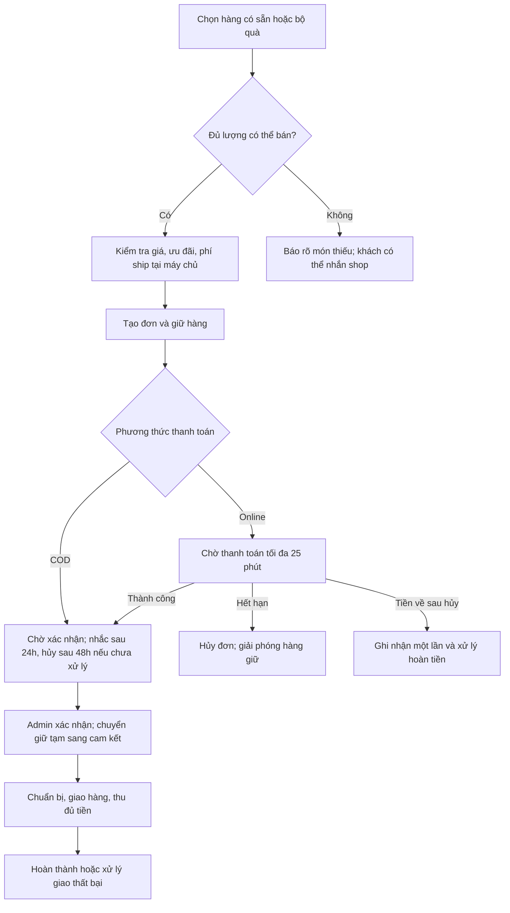
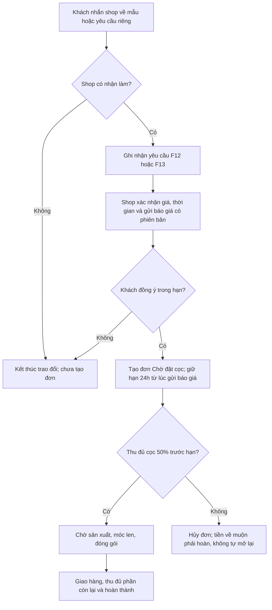

# Quy tắc nghiệp vụ dùng chung DA02

## 1. Phạm vi tổng hợp

Tổng hợp DA02.1 của Đức, bản Done tại DA02.2 của Bảo và DA02.3 của Tuấn thành quy tắc dùng chung theo các quyết định của Đức. Bản tổng hợp bao gồm mua hàng có sẵn, bộ quà, nhắn shop trao đổi khi hết hàng, đặt làm, cọc, thanh toán, tồn kho và hoàn tiền; được bàn giao để Châu feedback.

Bản frontend hiện có danh sách tám sản phẩm, giỏ quà nhiều khung và giỏ hàng dùng localStorage/stockDemo. DA01 đã được merge qua PR #43, mới có Express và hai đường dẫn kiểm tra máy chủ/database. Các quy tắc checkout, đơn hàng, giữ tồn, thanh toán và đặt làm dưới đây là đầu vào triển khai backend, không phải xác nhận các chức năng đó đã chạy.

## 2. Bộ quy tắc dùng chung

### 2.1. Phân biệt mua sẵn và đặt làm

Sản phẩm còn đúng mẫu, màu sắc, kích thước và đủ số lượng có thể bán: khách mua theo luồng hàng có sẵn, không yêu cầu đặt cọc riêng. Áp dụng theo bản Bảo: khách có thể mua bằng tài khoản hoặc không đăng nhập, nhưng phải cung cấp đủ thông tin nhận hàng và liên hệ. Guest tra cứu đơn bằng mã đơn kèm email hoặc số điện thoại đã đặt, không chỉ bằng mã đơn; Customer xem lịch sử đơn của mình. Gửi yêu cầu đặt làm F12/F13 chính thức vẫn cần tài khoản Customer; nhắn shop trao đổi trước chưa phải gửi yêu cầu đặt làm trên hệ thống.

Sản phẩm hết hàng: có điểm liên hệ “Nhắn shop đặt làm”, kèm tên/mã mẫu để khách trao đổi khả năng làm, giá và thời gian. Bấm liên hệ chưa tạo đơn, chưa yêu cầu cọc và không tự chuyển giỏ hàng thành đơn đặt làm. Nếu shop không nhận làm hoặc khách không đồng ý thì kết thúc trao đổi.

Nếu shop nhận làm theo mẫu thiết kế của shop và các tùy chọn được hỗ trợ, tiếp tục theo F12. Yêu cầu riêng ngoài tùy chọn hỗ trợ hoặc mẫu/ảnh riêng tiếp tục theo F13. Cả hai nhánh đều phải có thông tin yêu cầu và giá/thời gian được ghi nhận, khách đồng ý, rồi thu đủ tiền cọc đã xác nhận trước khi sản xuất. Trao đổi qua kênh liên hệ không thay thế hồ sơ yêu cầu, báo giá và giao dịch cần lưu trên hệ thống.

F12 là “đặt làm mới theo mẫu thiết kế của shop”, không đồng nghĩa với thành phẩm đang còn trong kho. Đơn đặt làm tách khỏi lần checkout mua hàng có sẵn/bộ quà. Nhắn shop dùng kênh liên hệ, không bổ sung hệ thống live chat thời gian thực vào phạm vi hiện tại.

### 2.2. Bộ quà và ngân sách

Ngân sách là tiền sản phẩm của một bộ. Gợi ý chỉ lấy bộ mẫu hợp lệ, đủ lượng cho một bộ và không vượt ngân sách; sắp theo giá tăng dần rồi mã bộ. Sau tùy chỉnh, vượt ngân sách chỉ cảnh báo, không chặn thêm giỏ nếu cấu hình hợp lệ và đủ lượng.

Mỗi bộ đang soạn có khung độc lập. Nhân bản tạo khung mới, mặc định một bộ, giữ nguyên bộ gốc. Giỏ gộp các bộ có cùng mã sản phẩm và số lượng từng mã trong một bộ; khác cấu hình thì giữ riêng. Tổng tiền và tổng số món phải nhân với số bộ.

Gói quà cơ bản không thu phí riêng; tiền hàng thay đổi theo sản phẩm và số lượng thực tế. Mỗi bộ được shop trang trí, gói riêng; hai bộ gộp trên một dòng giỏ vẫn là hai gói. Tùy chỉnh bộ quà từ hàng có sẵn không tự biến đơn thành đặt làm và không phát sinh cọc riêng.

Ngân sách, số lượng món và số bộ phải là số nguyên dương. Khách chỉ thêm/đổi sản phẩm trong danh sách được phép của bộ mẫu; bỏ món bằng thao tác Bỏ sản phẩm, không dùng số lượng 0. Khung soạn có thể rỗng nhưng bộ rỗng không được thêm giỏ. Nhân bản không tự thêm giỏ, không giảm số bộ gốc; sửa khung sau khi thêm không tự thay đổi dòng đã có trong giỏ.

Khi gộp cấu hình, không phụ thuộc thứ tự món, tên bộ, mã bộ mẫu hoặc ngân sách; giữ tên và ngân sách của dòng cũ. Thao tác thêm lại tiếp tục tăng số bộ. Chỉ cập nhật giỏ và khung soạn sau khi lưu thành công; lỗi lưu phải giữ dữ liệu cũ và báo lỗi. Giỏ và khung dùng các khóa localStorage riêng trong cùng origin; số đếm trên biểu tượng giỏ là tổng số món thực tế, không phải số dòng hoặc số bộ. Khi chuyển sang backend, giá và tồn chính thức lấy từ PostgreSQL.

### 2.3. Giá, khuyến mãi, voucher và vận chuyển

Đối với cùng một đơn mua sẵn, tính chung tiền hàng lẻ và thành phần các bộ quà. Thứ tự tính: tổng giá gốc → khuyến mãi sản phẩm → kiểm tra và áp dụng một voucher hợp lệ → xét miễn ship → cộng phí vận chuyển. Voucher chỉ giảm các sản phẩm/nhóm sản phẩm thuộc phạm vi áp dụng, không giảm tiền ship.

Theo bản Bảo: điều kiện giá trị đơn tối thiểu của voucher tính trên tiền hàng sau khuyến mãi sản phẩm, trước khi trừ voucher; kiểm tra thêm thời hạn, lượt dùng, phạm vi sản phẩm và mức giảm tối đa của mã. Tổng giảm từ khuyến mãi và voucher không vượt 50% tổng giá gốc; nếu vượt, từ chối ưu đãi được thêm sau cùng và thông báo rõ cho khách. Trường hợp không được kết hợp, chọn ưu đãi có lợi hơn theo điều kiện chương trình.

Phí giao hàng theo vùng cấu hình: nội thành TP.HCM 20.000đ; ngoại thành TP.HCM 30.000đ; khu vực tỉnh/thành khác được hỗ trợ 40.000đ. Miễn ship khi tổng tiền hàng sau khuyến mãi và voucher đạt từ 300.000đ, chưa cộng phí vận chuyển. Danh sách phường/xã theo vùng phải được cấu hình thống nhất, không suy ra phí từ tên quận/huyện cũ.

Khi sửa sản phẩm, số lượng hoặc địa chỉ, kiểm tra lại điều kiện ưu đãi, phí giao hàng và tổng tiền. Giỏ hàng trước khi tạo đơn được gỡ voucher không còn hợp lệ và thông báo; khi sửa một đơn đã tạo thì phải kiểm tra trước khi lưu, hiển thị thay đổi để khách xác nhận. Trong thời gian đơn còn hiệu lực và khách còn được tiếp tục thanh toán, giữ voucher/lượt đang gắn với đơn, kể cả khi một lần giao dịch bị lỗi. Khi thanh toán kết thúc thất bại và đơn không còn tiếp tục, đơn hết hạn hoặc COD tự hủy, trả lại lượt theo bản Bảo nếu voucher còn hạn; xử lý trả lượt một lần, không gia hạn voucher. Khách chủ động hủy vẫn theo điều kiện riêng của mã.

Khi tạo đơn, lưu tên/mã sản phẩm hoặc biến thể, cấu hình bộ quà, giá từng món, số lượng, khuyến mãi, voucher, phí vận chuyển và tổng thanh toán tại thời điểm đặt. Danh mục thay đổi sau đó không làm đổi giá hoặc cấu hình lịch sử của đơn. Khi sửa một đơn còn được phép sửa, sản phẩm và số lượng không thay đổi giữ giá lúc đặt; phần thêm mới, thay thế hoặc số lượng tăng thêm dùng giá tại thời điểm khách xác nhận sửa. Hiển thị nội dung cũ và mới trước khi lưu; không lưu nếu thiếu hàng hoặc voucher của đơn sửa không còn hợp lệ.

### 2.4. Tồn kho dùng chung

Tính nhu cầu của mỗi mã biến thể trên toàn đơn: lượng mua lẻ + tổng (lượng trong một bộ × số bộ). Khi một món thiếu hàng hoặc ngừng bán, báo rõ bộ bị ảnh hưởng, tên/mã món, tổng lượng cần và lượng có thể bán; chưa tạo đơn, không tự bỏ hoặc thay món.

Hàng đang soạn hoặc nằm trong giỏ chưa giữ chỗ tồn kho. Khi tạo đơn hợp lệ, máy chủ giữ hàng trong giao dịch phù hợp để tránh mua đồng thời vượt số lượng. Ngay lúc giữ hàng, lượng đó không còn được bán cho đơn khác. Khi Admin xác nhận, chuyển từ giữ tạm sang cam kết cho đơn, không trừ lượng có thể bán lần thứ hai.

Hàng vẫn có thể còn tại cửa hàng sau khi đã cam kết; bàn giao cho đơn vị vận chuyển mới là xuất kho vật lý. Hủy trước xuất kho thì giải phóng phần đã giữ/cam kết. Sau xuất kho chỉ cộng lại hàng có thể bán khi hàng hoàn về và được kiểm tra. Tồn kho thực tế, lượng giữ/cam kết và lượng có thể bán phải được phân biệt khi thiết kế dữ liệu.

Nếu phát hiện thiếu hàng thực tế sau khi đã tạo đơn, Admin chưa xác nhận hoặc tạm dừng chuẩn bị, ghi món/lượng thiếu và liên hệ khách trong 24 giờ. Khách có thể giảm lượng, đổi món hoặc hủy. Với COD, chỉ cập nhật cấu hình, giá, ưu đãi, ship và tổng thu sau khi khách đồng ý; với đơn đã thanh toán online, hủy và hoàn toàn bộ đơn cũ, khách tạo đơn mới nếu muốn đổi. Không liên hệ được trong 24 giờ thì Admin được hủy và phải ghi lý do.

Mọi lần giữ, chuyển sang cam kết, giải phóng hoặc nhận hàng hoàn phải lưu mã đơn, mã sản phẩm/biến thể, số lượng, lý do và thời gian. Hàng hoàn hỏng hoặc không còn bán được không được cộng vào lượng có thể bán.

### 2.5. Thanh toán và xử lý đơn mua sẵn

Online: thời hạn 25 phút tính từ lúc tạo đơn. Thử lại thanh toán hoặc sửa đơn không làm mới thời hạn. Chuyển sang COD chỉ khi đơn còn hạn và địa chỉ được hỗ trợ; trạng thái chuyển sang Chờ xác nhận. Hết hạn chưa ghi nhận thành công thì hủy đơn và giải phóng hàng giữ.

Nếu kết quả thanh toán thành công đến sau khi đơn đã bị hủy, ghi nhận giao dịch hợp lệ một lần và xử lý hoàn toàn bộ tiền đã thu, không tự khôi phục đơn. Giao dịch đang xử lý phải được đối chiếu tiếp theo mã tham chiếu; không coi việc chưa nhận callback là bằng chứng chắc chắn khách chưa bị thu tiền.

COD: bắt đầu ở Chờ xác nhận, chưa thanh toán. Sau 24 giờ kể từ tạo đơn mà Admin chưa xử lý thì nhắc Admin; đủ 48 giờ vẫn chưa xử lý thì tự hủy và giải phóng hàng giữ. Chỉ ghi nhận đã thanh toán khi có xác nhận đã thu tiền; chỉ hoàn thành khi giao thành công và nghĩa vụ thanh toán đã đủ.

Luồng đơn mua: Chờ thanh toán (online) → Chờ xác nhận → Đã xác nhận → Đang chuẩn bị hàng → Đang giao hàng → Hoàn thành. Các nhánh hủy/giao thất bại quản lý riêng. Mỗi lần chuyển trạng thái phải lưu điều kiện, thời gian và người thực hiện.

Admin kiểm tra thông tin, tồn thực tế, xác nhận/từ chối, chuẩn bị hàng, bàn giao vận chuyển và ghi nhận kết quả giao. Chỉ chuyển trạng thái theo điều kiện của bước hiện tại, không nhảy từ Chờ xác nhận thẳng sang Đang giao hàng. Giao thất bại phải ghi lý do; giao lại chuyển về Đang giao hàng, thành công mới Hoàn thành, giao lại vẫn thất bại hoặc không liên hệ được thì Admin xử lý hủy.

Thanh toán đơn mua được theo dõi riêng: Chưa thanh toán → Đang xử lý → Đã thanh toán hoặc Thanh toán thất bại; khách thử lại chỉ trong thời hạn còn lại. COD giữ Chưa thanh toán đến khi xác nhận thu tiền. Các trạng thái hoàn tiền dùng quy trình chung ở mục 2.6; hủy đơn không đồng nghĩa đã hoàn tiền.

### 2.6. Sửa, hủy và hoàn tiền đơn mua

Theo bản Bảo, khách được sửa đơn chưa thanh toán hoặc COD đang Chờ xác nhận nếu Admin chưa xử lý. Đơn đã thanh toán online chỉ tự sửa thông tin không làm thay đổi số tiền; muốn đổi hàng/số lượng làm thay đổi tổng tiền thì hủy hợp lệ và tạo đơn mới. Khi thiếu hàng sau thanh toán online, xử lý hủy và hoàn toàn bộ đơn cũ thay vì tự thu thêm/hoàn một phần.

Hủy trước khi bàn giao vận chuyển được chấp thuận thì hoàn toàn bộ số tiền đã trả. Lỗi cửa hàng/đơn vị vận chuyển thì hoàn toàn bộ, gồm phí giao hàng. Giao thất bại do lỗi khách: khoản hoàn trừ chi phí giao/hoàn hàng thực tế nếu có, phải thông báo trước. COD chưa thu tiền không phát sinh hoàn tiền.

Admin liên hệ để giao lại tối đa một lần, sắp xếp trong 24 giờ sau khi khách đồng ý. Phí giao lại do lỗi khách tính theo chi phí thực tế và chỉ thực hiện sau khi khách đồng ý mức phí. Việc hủy và trả hàng về kho không được làm mất lịch sử đơn.

Dùng chung quy trình hoàn tiền cho đơn mua sẵn và đặt làm. Khi xác định có khoản phải hoàn, ghi Chờ hoàn tiền; gửi yêu cầu cho đơn vị thanh toán trong một ngày làm việc từ khi quyết định hoàn được ghi nhận. Sau khi gửi yêu cầu, chuyển Đang hoàn tiền; thời gian dự kiến 3–5 ngày làm việc tính từ lúc đơn vị thanh toán tiếp nhận. Chỉ chuyển Đã hoàn tiền khi có kết quả thành công; lỗi xử lý thì Hoàn tiền thất bại để Admin kiểm tra, không ghi hoàn trùng khi thử lại. Hoàn về phương thức ban đầu, không quy đổi giảm giá voucher thành tiền.

Khách tự hủy khi đơn Chờ thanh toán hoặc Chờ xác nhận, theo phương thức thanh toán ở trên. Từ Đã xác nhận hoặc Đang chuẩn bị hàng, sửa/hủy phải liên hệ và được Admin chấp thuận; Đang giao hàng không được tự sửa/hủy. Giao hàng thất bại chỉ sửa thông tin phục vụ giao lại qua cửa hàng. Khi hủy, lưu lý do, thời gian, người xử lý, trạng thái trước hủy, lượng giải phóng và khoản phải hoàn. Đơn mua bị hủy do lỗi cửa hàng được trả lượt voucher nếu mã còn hạn; khách chủ động hủy theo điều kiện riêng của mã.

### 2.7. Báo giá và cọc đơn đặt làm

Shop xác nhận khả năng làm, giá và thời gian trước khi khách đồng ý. Báo giá có phiên bản; khi đổi giá/thời gian phải tạo bản mới, đánh dấu bản cũ đã thay thế và yêu cầu khách xác nhận bản hiện hành. Từ lúc khách chấp nhận báo giá, nội dung chốt được khóa; khách không tự sửa trực tiếp, nếu cần thay đổi phải liên hệ cửa hàng để xử lý.

Theo quyết định của Đức: mọi đơn đặt làm phải thu đủ cọc trước sản xuất. Hạn chấp nhận và cọc nằm trong cùng 24 giờ tính từ lúc shop gửi báo giá/xác nhận nhận làm; khách đồng ý không được cộng thêm 24 giờ. Phiên thanh toán tối đa 25 phút nhưng không vượt hạn báo giá. Tiền cọc không làm tròn đến 1.000đ; tổng tiền, cọc, đã thu và còn lại được lưu tách biệt.

Cọc cố định 50% tiền hàng đặt làm cho cả F12 và F13, không tính phí vận chuyển vào cơ sở tính cọc. Tiền cọc thanh toán online qua cổng Sandbox, không dùng COD cho khoản cọc. Phần còn lại = tổng tiền phải thanh toán trừ tổng tiền hợp lệ đã thu; thu COD khi giao thành công hoặc thanh toán Sandbox ở trạng thái Đóng gói trước khi giao. Giao dịch thành công chỉ cộng tiền một lần; đơn đã hủy mà nhận tiền muộn phải hoàn toàn bộ khoản thu, không tự mở lại sản xuất.
Đơn đặt làm không áp dụng voucher trong phiên bản đầu. Phí vận chuyển dùng chung biểu phí 20.000đ/30.000đ/40.000đ theo vùng; miễn phí vận chuyển khi tiền hàng đặt làm đã xác nhận đạt từ 300.000đ, chưa tính ship.
Mỗi yêu cầu có số lượng nguyên từ 1 đến 10 món. Ảnh tham khảo F13 tối đa ba ảnh, định dạng .jpg/.jpeg/.png/.webp, dung lượng không quá 5 MB/ảnh. Ngày mong muốn nhận hàng phải cách ít nhất năm ngày kể từ ngày gửi yêu cầu; shop vẫn phải xác nhận khả năng đáp ứng và thời gian thực tế trước khi khách đồng ý. Shop phản hồi yêu cầu trong vòng 24 giờ kể từ khi nhận; mốc này khác với hạn báo giá/cọc 24 giờ tính từ lúc shop gửi báo giá.

Admin xử lý yêu cầu theo ba hướng: thiếu thông tin thì chuyển Cần bổ sung thông tin và ghi rõ cần bổ sung; khách cập nhật xong quay về Chờ cửa hàng xem xét; không làm được thì Bị từ chối kèm lý do; nhận làm thì xác nhận thông số và giá dự kiến theo mẫu F12 hoặc lập báo giá chính thức cho F13. Giá dự kiến F12 chưa phải căn cứ thu cọc khi shop chưa xác nhận khả năng làm và thời gian.

Mỗi báo giá có số phiên bản, nội dung yêu cầu, tiền hàng, ship, cọc, thời gian thực hiện, thời điểm gửi và hết hạn. Bản mới có hạn 24 giờ từ lúc được gửi; bản cũ bị đánh dấu Đã thay thế, không được chấp nhận nữa. Chỉ báo giá hiện hành còn hạn mới nhận phản hồi. Khách từ chối thì kết thúc nhánh báo giá, không sản xuất; không phản hồi đến hạn thì Báo giá hết hiệu lực, không coi im lặng là đồng ý.

Khách chấp nhận báo giá thì khóa cấu hình và phiên bản đã chốt, tạo duy nhất một đơn Chờ đặt cọc; bấm lặp không được tạo đơn trùng. Hạn cọc của đơn giữ nguyên hạn báo giá đã chấp nhận. Hết hạn chưa đủ cọc thì hủy đơn và giải phóng lịch sản xuất; thu đủ cọc hợp lệ trước hạn mới chuyển Chờ sản xuất. Chỉ Hoàn thành khi giao thành công và đã thu đủ tổng tiền phải trả.

### 2.8. Hủy đơn đặt làm và trạng thái

Theo bản Tuấn: hủy được duyệt trước khi móc len thì hoàn toàn bộ tiền đã thu; cửa hàng không thực hiện đúng cam kết thì hoàn toàn bộ. Khi khách đổi ý hủy trong giai đoạn sản xuất/đóng gói, giữ khoản cọc và hoàn phần đã thu ngoài cọc theo quyết định Đức đã nêu. Ví dụ tiền hàng 280.000đ, ship 20.000đ, đã trả đủ 300.000đ và cọc 140.000đ thì hoàn 160.000đ. Hủy khi đang giao do Admin xử lý sau khi liên hệ, không cho khách tự hủy trực tiếp.

Luồng đặt làm: yêu cầu/xem xét → báo giá → khách đồng ý → Chờ đặt cọc → Chờ sản xuất → Đang móc len → Đóng gói → Giao hàng → Hoàn thành. Trạng thái yêu cầu/báo giá, đơn và thanh toán được quản lý riêng. Hủy đơn không mặc nhiên đồng nghĩa đã hoàn tiền; trạng thái hoàn tiền và khoản tiền còn cần xử lý phải được theo dõi.

Trước khi thu cọc, khách được hủy yêu cầu/đơn và không phát sinh hoàn nếu chưa thu tiền. Đã cọc nhưng chưa móc len thì liên hệ cửa hàng; Admin duyệt hủy sẽ hoàn toàn bộ tiền đã thu, kể cả phần trả thêm ngoài cọc. Việc cho phép hủy theo giai đoạn tách biệt với thời gian xử lý hoàn tiền 3–5 ngày làm việc.

Đơn đặt làm đang giao hoặc giao thất bại: hỗ trợ giao lại tối đa một lần. Nếu khách vẫn từ chối nhận, Admin xử lý hủy, giữ tiền cọc và hoàn phần đã thu vượt cọc; không cộng thêm khoản khấu trừ của luồng mua sẵn vào quy tắc đặt làm này. Nếu hàng lỗi/sai mẫu đã chốt do cửa hàng và khách không đồng ý làm lại, cửa hàng nhận hàng hoàn rồi hoàn toàn bộ tiền đã thu.

Trạng thái yêu cầu/báo giá gồm Chờ cửa hàng xem xét, Cần bổ sung thông tin, Chờ khách phản hồi báo giá, Khách đã chấp nhận báo giá, Báo giá bị từ chối, Báo giá hết hiệu lực và Bị từ chối/Đã hủy yêu cầu. Đơn đặt làm có thêm nhánh Giao hàng thất bại và Đã hủy ngoài luồng thông thường. Thanh toán đặt làm theo dõi Chưa thanh toán, Thanh toán thất bại, Đã đặt cọc, Đã thanh toán đủ cùng bốn trạng thái hoàn tiền chung ở mục 2.6; không gộp ba nhóm trạng thái thành một.

### 2.9. Thông tin yêu cầu và kiểm tra trên máy chủ

Đơn mua cần họ tên, số điện thoại, email và địa chỉ nhận hàng đầy đủ. Địa chỉ có tỉnh/thành, thông tin khu vực theo biểu mẫu và địa chỉ cụ thể đủ tìm nơi nhận; số điện thoại đúng định dạng, địa chỉ thuộc vùng hỗ trợ. Khi triển khai, danh sách địa chỉ phải thống nhất với cấu hình giao hàng hiện hành. Thiếu thông tin hoặc ngoài vùng hỗ trợ thì chưa tạo đơn và chỉ rõ lỗi cần sửa.

Yêu cầu đặt làm ghi mẫu gốc (bắt buộc F12, tùy chọn F13), tên/chủ đề món đồ, màu, kích thước, nội dung cá nhân hóa/ghi chú, ảnh tham khảo theo nhánh, số lượng, ngày mong muốn nhận và thông tin người nhận/địa chỉ. Kiểm tra trường bắt buộc, tùy chọn mẫu và giới hạn món/ảnh/ngày ở mục 2.7 trước khi tiếp nhận; tệp không hợp lệ hoặc tải lỗi không được lưu như đã thành công.

Máy chủ kiểm tra quyền Customer đối với chính yêu cầu, báo giá và đơn của mình; thao tác quản trị chỉ dành cho vai trò được cấp quyền. Máy chủ lấy giá/tồn từ PostgreSQL, kiểm tra sản phẩm còn bán và danh sách món được phép, tính lại tiền hàng, ưu đãi, ship, cọc và số còn lại; không tin tổng tiền, giá hoặc quyền do giao diện/localStorage gửi lên.

Lưu riêng yêu cầu, lịch sử báo giá, cấu hình/giá đã chốt của đơn, giao dịch và lịch sử trạng thái. Mỗi mã giao dịch chỉ cộng tiền hoặc ghi hoàn một lần; xử lý đồng thời phải ngăn tạo đơn trùng, vượt tồn và cập nhật sai số đã thu. Khi nhận kết quả thanh toán, kiểm tra đơn, số tiền, trạng thái và hạn hiệu lực trước khi chuyển sang sản xuất. Cấu trúc bảng cụ thể do DA03 thiết kế theo các ràng buộc này; chưa xem mô hình đề xuất trong bài Tuấn là database đã triển khai.

### 2.10. Thông báo và bảo vệ thông tin đơn

Tạo đơn thành công phải có mã đơn riêng, hiển thị kết quả và gửi email xác nhận gồm mã đơn, sản phẩm, tổng tiền, phương thức thanh toán và trạng thái ban đầu. Khi phát sinh hoàn tiền, thông báo mã đơn, lý do, số tiền, phương thức nhận và thời gian dự kiến; khách theo dõi được kết quả xử lý.

Tra cứu vãng lai chỉ trả kết quả khi khớp mã đơn với email hoặc số điện thoại đặt hàng. Không khớp thì dùng thông báo chung Không tìm thấy đơn hàng phù hợp, không chỉ ra trường nào sai; che bớt thông tin cá nhân khi hiển thị. Customer chỉ xem lịch sử của mình; chức năng tra cứu cần hạn chế thử sai liên tiếp theo cấu hình bảo mật, không tiết lộ thông tin đơn của người khác.

## 3. Nguồn và tài liệu bàn giao

[DA02.1 — Quy tắc bộ quà](https://docs.google.com/document/d/1V3NdIGiTeoN_ShX-vEe1GK4qIG4zNve8ezKFrvLF4qA/edit?tab=t.vsuyt08skxc2)

[DA02.2 — Bản Done của Bảo](https://docs.google.com/document/d/1V3NdIGiTeoN_ShX-vEe1GK4qIG4zNve8ezKFrvLF4qA/edit?tab=t.tk3up8hvnu06)

[DA02.3 — Quy tắc đặt làm và báo giá của Tuấn](https://docs.google.com/document/d/1V3NdIGiTeoN_ShX-vEe1GK4qIG4zNve8ezKFrvLF4qA/edit?tab=t.7z7pp0qv6958)

Bản tổng hợp và phần đồng bộ REQUIREMENTS.md, docs/business-workflow.md được bàn giao qua PR tài liệu; không thay đổi mã frontend/backend hoặc tạo thêm bảng dữ liệu trong nhiệm vụ này.

## 4. Đối chiếu và các tình huống cần kiểm tra

Đã đối chiếu ba phần nghiệp vụ và trạng thái mã hiện hành. Những tình huống dưới đây là kết quả mong đợi theo quy tắc, không phải kết quả API đã chạy thành công.

### 4.1. Hai bộ giống nhau

Một bộ 80.000đ, chọn hai bộ: tiền hàng 160.000đ; chuẩn bị hai gói quà cơ bản; phí gói riêng bằng 0.

### 4.2. Đơn có bộ quà và hàng lẻ

Giả định voucher toàn đơn hợp lệ: hai bộ 160.000đ + hàng lẻ 190.000đ = 350.000đ; khuyến mãi sản phẩm 20.000đ, voucher 30.000đ. Tiền hàng còn 300.000đ nên miễn ship; tổng trả 300.000đ.

### 4.3. Chưa đạt ngưỡng miễn ship

Tiền hàng 350.000đ, giảm tổng 60.000đ còn 290.000đ; vùng phí 20.000đ thì tổng trả 310.000đ.

### 4.4. Vượt giới hạn giảm giá

Giá gốc 400.000đ, khuyến mãi 180.000đ, thêm voucher 40.000đ: tổng giảm 220.000đ > 200.000đ. Từ chối voucher thêm sau; tiền hàng sau khuyến mãi vẫn là 220.000đ, chưa tính ship.

### 4.5. Lượng gộp và món thiếu

KC-001 có thể bán 20; mua lẻ 18 + hai bộ mỗi bộ dùng một KC-001 thì cần 20. Thêm một bộ làm nhu cầu 21: từ chối, báo rõ mã thiếu và không lưu đơn vượt lượng.

### 4.6. Hết hàng và nhắn shop

Khách bấm liên hệ về mẫu hết hàng: chưa tạo đơn/chưa thu cọc. Shop không nhận làm thì kết thúc; shop nhận và khách đồng ý giá/thời gian thì tiếp tục F12, thu đủ cọc trước sản xuất.

### 4.7. Thời hạn đơn mua

Đơn online tạo 10:00 hết hạn 10:25; thử thanh toán lại không gia hạn. Đơn COD tạo 10:00 ngày 16/11: nhắc 10:00 ngày 17/11, tự hủy 10:00 ngày 18/11 nếu vẫn chưa xử lý.

### 4.8. Thời hạn và tiền đơn đặt làm

Báo giá gửi 10:00 ngày 16/11 hết hạn 10:00 ngày 17/11; đồng ý lúc 09:00 chỉ còn một giờ để cọc. Theo mức cọc cố định 50% trên tiền hàng 280.000đ, ship 20.000đ: cọc 140.000đ, còn lại 160.000đ. Đã trả 300.000đ rồi hủy khi đang sản xuất: giữ cọc 140.000đ, hoàn 160.000đ.

### 4.9. Giữ giá và sửa đơn

Đơn COD chưa được Admin xử lý có một KC-001 đã đặt giá 45.000đ. Sau khi giá tăng lên 50.000đ, khách tăng lên hai món: món cũ giữ 45.000đ, món tăng thêm dùng 50.000đ, tiền hàng 95.000đ trước ưu đãi/ship. Hiển thị chênh lệch để khách xác nhận; thiếu hàng hoặc voucher không hợp lệ thì không lưu sửa.

### 4.10. Thiếu hàng thực tế sau khi tạo đơn

Admin phát hiện thiếu hàng lúc 09:00 thì ghi món thiếu và liên hệ trong 24 giờ. COD chỉ giảm lượng/đổi món và tính lại tiền sau khi khách đồng ý; đơn online đã thanh toán phải hủy, hoàn toàn bộ đơn cũ và cho khách tạo đơn mới. Không liên hệ được trong 24 giờ thì Admin được hủy có lý do, không tự thay món.

### 4.11. Báo giá mới và chống tạo đơn trùng

Bản v1 gửi 10:00 ngày 16/11, v2 gửi 14:00 cùng ngày: v1 bị thay thế, v2 hết hạn 14:00 ngày 17/11. Khách chỉ chấp nhận v2 còn hạn; bấm đồng ý hai lần vẫn chỉ có một đơn Chờ đặt cọc, giữ hạn 14:00 ngày 17/11. Không chấp nhận bản cũ hoặc tự kéo dài hạn cọc sau khi đồng ý.

### 4.12. Bổ sung hoặc từ chối yêu cầu đặt làm

Yêu cầu đã tiếp nhận thiếu chi tiết để báo giá thì Admin ghi rõ nội dung cần bổ sung, chuyển Cần bổ sung thông tin; khách cập nhật xong quay về Chờ cửa hàng xem xét. Shop không làm được thì từ chối có lý do, không tạo đơn sản xuất hoặc thu cọc.

### 4.13. Hủy và giao thất bại của đơn đặt làm

Tiền hàng 280.000đ, ship 20.000đ, cọc 140.000đ. Nếu Admin duyệt hủy trước sản xuất và đã thu đủ 300.000đ, hoàn 300.000đ. Nếu đã giao lại một lần mà khách vẫn không nhận, giữ cọc 140.000đ, hoàn 160.000đ đã thu ngoài cọc. Lỗi/sai mẫu do shop và khách không đồng ý làm lại thì nhận hàng hoàn, hoàn toàn bộ tiền đã thu.

### 4.14. Quyền truy cập và dữ liệu thanh toán

Customer A không được xem/sửa đơn của B; Guest chỉ biết mã đơn không được tra cứu. Sửa tổng tiền hoặc giá trong dữ liệu giao diện không làm thay đổi giá máy chủ tính. Thông báo cùng một giao dịch thành công hai lần chỉ cộng tiền một lần; đơn đã hủy nhận tiền trễ vẫn giữ Đã hủy và chuyển sang quy trình hoàn tiền.

## 5. Sơ đồ luồng tổng hợp

