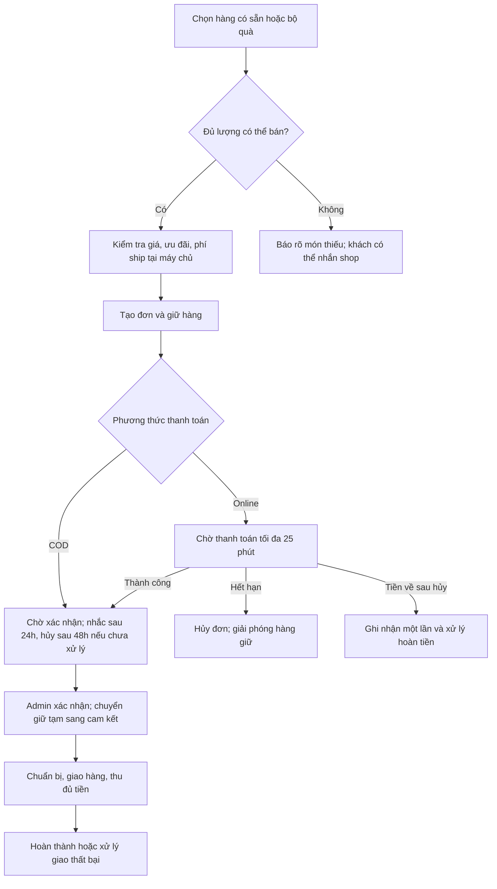
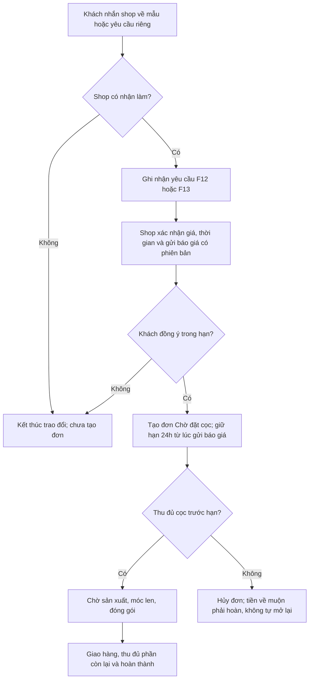

# Quy tắc nghiệp vụ dùng chung DA02

## 1. Phạm vi tổng hợp

Tổng hợp DA02.1 của Đức, bản Done tại DA02.2 của Bảo và DA02.3 của Tuấn thành quy tắc dùng chung. Các quyết định mới của Đức về mua hàng có sẵn, nhắn shop khi hết hàng và đặt cọc được đưa vào mục 2.1. Những điểm chưa thống nhất được tách tại mục 5, chưa coi là yêu cầu cuối để triển khai.

Bản frontend hiện có danh sách tám sản phẩm, giỏ quà nhiều khung và giỏ hàng dùng localStorage/stockDemo. DA01 đã được merge qua PR #43, mới có Express và hai đường dẫn kiểm tra máy chủ/database. Các quy tắc checkout, đơn hàng, giữ tồn, thanh toán và đặt làm dưới đây là đầu vào triển khai backend, không phải xác nhận các chức năng đó đã chạy.

## 2. Bộ quy tắc dùng chung

### 2.1. Phân biệt mua sẵn và đặt làm

Sản phẩm còn đúng mẫu, màu sắc, kích thước và đủ số lượng có thể bán: khách mua theo luồng hàng có sẵn, không yêu cầu đặt cọc riêng. Thanh toán toàn bộ online hoặc COD được xử lý theo quy tắc đơn mua.

Sản phẩm hết hàng: có điểm liên hệ “Nhắn shop đặt làm”, kèm tên/mã mẫu để khách trao đổi khả năng làm, giá và thời gian. Bấm liên hệ chưa tạo đơn, chưa yêu cầu cọc và không tự chuyển giỏ hàng thành đơn đặt làm. Nếu shop không nhận làm hoặc khách không đồng ý thì kết thúc trao đổi.

Nếu shop nhận làm theo mẫu thiết kế của shop và các tùy chọn được hỗ trợ, tiếp tục theo F12. Yêu cầu riêng ngoài tùy chọn hỗ trợ hoặc mẫu/ảnh riêng tiếp tục theo F13. Cả hai nhánh đều phải có thông tin yêu cầu và giá/thời gian được ghi nhận, khách đồng ý, rồi thu đủ tiền cọc đã xác nhận trước khi sản xuất. Trao đổi qua kênh liên hệ không thay thế hồ sơ yêu cầu, báo giá và giao dịch cần lưu trên hệ thống.

F12 là “đặt làm mới theo mẫu thiết kế của shop”, không đồng nghĩa với thành phẩm đang còn trong kho. Đơn đặt làm tách khỏi lần checkout mua hàng có sẵn/bộ quà. Nhắn shop dùng kênh liên hệ, không bổ sung hệ thống live chat thời gian thực vào phạm vi hiện tại.

### 2.2. Bộ quà và ngân sách

Ngân sách là tiền sản phẩm của một bộ. Gợi ý chỉ lấy bộ mẫu hợp lệ, đủ lượng cho một bộ và không vượt ngân sách; sắp theo giá tăng dần rồi mã bộ. Sau tùy chỉnh, vượt ngân sách chỉ cảnh báo, không chặn thêm giỏ nếu cấu hình hợp lệ và đủ lượng.

Mỗi bộ đang soạn có khung độc lập. Nhân bản tạo khung mới, mặc định một bộ, giữ nguyên bộ gốc. Giỏ gộp các bộ có cùng mã sản phẩm và số lượng từng mã trong một bộ; khác cấu hình thì giữ riêng. Tổng tiền và tổng số món phải nhân với số bộ.

Gói quà cơ bản không thu phí riêng; tiền hàng thay đổi theo sản phẩm và số lượng thực tế. Mỗi bộ được shop trang trí, gói riêng; hai bộ gộp trên một dòng giỏ vẫn là hai gói. Tùy chỉnh bộ quà từ hàng có sẵn không tự biến đơn thành đặt làm và không phát sinh cọc riêng.

### 2.3. Giá, khuyến mãi, voucher và vận chuyển

Đối với cùng một đơn mua sẵn, tính chung tiền hàng lẻ và thành phần các bộ quà. Thứ tự tính: tổng giá gốc → khuyến mãi sản phẩm → kiểm tra và áp dụng một voucher hợp lệ → xét miễn ship → cộng phí vận chuyển. Voucher chỉ giảm các sản phẩm/nhóm sản phẩm thuộc phạm vi áp dụng, không giảm tiền ship.

Theo bản Bảo: điều kiện giá trị đơn tối thiểu của voucher tính trên tiền hàng sau khuyến mãi sản phẩm, trước khi trừ voucher; kiểm tra thêm thời hạn, lượt dùng, phạm vi sản phẩm và mức giảm tối đa của mã. Tổng giảm từ khuyến mãi và voucher không vượt 50% tổng giá gốc; nếu vượt, từ chối ưu đãi được thêm sau cùng và thông báo rõ cho khách. Trường hợp không được kết hợp, chọn ưu đãi có lợi hơn theo điều kiện chương trình.

Phí giao hàng theo vùng cấu hình: nội thành TP.HCM 20.000đ; ngoại thành TP.HCM 30.000đ; khu vực tỉnh/thành khác được hỗ trợ 40.000đ. Miễn ship khi tổng tiền hàng sau khuyến mãi và voucher đạt từ 300.000đ, chưa cộng phí vận chuyển. Danh sách phường/xã theo vùng phải được cấu hình thống nhất, không suy ra phí từ tên quận/huyện cũ.

Khi sửa sản phẩm, số lượng hoặc địa chỉ, kiểm tra lại điều kiện ưu đãi, phí giao hàng và tổng tiền. Giỏ hàng trước khi tạo đơn được gỡ voucher không còn hợp lệ và thông báo; khi sửa một đơn đã tạo thì phải kiểm tra trước khi lưu, hiển thị thay đổi để khách xác nhận. Các điểm còn thiếu về lượt voucher được ghi tại mục 5.3.

### 2.4. Tồn kho dùng chung

Tính nhu cầu của mỗi mã biến thể trên toàn đơn: lượng mua lẻ + tổng (lượng trong một bộ × số bộ). Khi một món thiếu hàng hoặc ngừng bán, báo rõ bộ bị ảnh hưởng, tên/mã món, tổng lượng cần và lượng có thể bán; chưa tạo đơn, không tự bỏ hoặc thay món.

Hàng đang soạn hoặc nằm trong giỏ chưa giữ chỗ tồn kho. Khi tạo đơn hợp lệ, máy chủ giữ hàng trong giao dịch phù hợp để tránh mua đồng thời vượt số lượng. Ngay lúc giữ hàng, lượng đó không còn được bán cho đơn khác. Khi Admin xác nhận, chuyển từ giữ tạm sang cam kết cho đơn, không trừ lượng có thể bán lần thứ hai.

Hàng vẫn có thể còn tại cửa hàng sau khi đã cam kết; bàn giao cho đơn vị vận chuyển mới là xuất kho vật lý. Hủy trước xuất kho thì giải phóng phần đã giữ/cam kết. Sau xuất kho chỉ cộng lại hàng có thể bán khi hàng hoàn về và được kiểm tra. Tồn kho thực tế, lượng giữ/cam kết và lượng có thể bán phải được phân biệt khi thiết kế dữ liệu.

### 2.5. Thanh toán và xử lý đơn mua sẵn

Online: thời hạn 25 phút tính từ lúc tạo đơn. Thử lại thanh toán hoặc sửa đơn không làm mới thời hạn. Chuyển sang COD chỉ khi đơn còn hạn và địa chỉ được hỗ trợ; trạng thái chuyển sang Chờ xác nhận. Hết hạn chưa ghi nhận thành công thì hủy đơn và giải phóng hàng giữ.

Nếu kết quả thanh toán thành công đến sau khi đơn đã bị hủy, ghi nhận giao dịch hợp lệ một lần và xử lý hoàn toàn bộ tiền đã thu, không tự khôi phục đơn. Giao dịch đang xử lý phải được đối chiếu tiếp theo mã tham chiếu; không coi việc chưa nhận callback là bằng chứng chắc chắn khách chưa bị thu tiền.

COD: bắt đầu ở Chờ xác nhận, chưa thanh toán. Sau 24 giờ kể từ tạo đơn mà Admin chưa xử lý thì nhắc Admin; đủ 48 giờ vẫn chưa xử lý thì tự hủy và giải phóng hàng giữ. Chỉ ghi nhận đã thanh toán khi có xác nhận đã thu tiền; chỉ hoàn thành khi giao thành công và nghĩa vụ thanh toán đã đủ.

Luồng đơn mua: Chờ thanh toán (online) → Chờ xác nhận → Đã xác nhận → Đang chuẩn bị hàng → Đang giao hàng → Hoàn thành. Các nhánh hủy/giao thất bại quản lý riêng. Mỗi lần chuyển trạng thái phải lưu điều kiện, thời gian và người thực hiện.

### 2.6. Sửa, hủy và hoàn tiền đơn mua

Theo bản Bảo, khách được sửa đơn chưa thanh toán hoặc COD đang Chờ xác nhận nếu Admin chưa xử lý. Đơn đã thanh toán online chỉ tự sửa thông tin không làm thay đổi số tiền; muốn đổi hàng/số lượng làm thay đổi tổng tiền thì hủy hợp lệ và tạo đơn mới. Khi thiếu hàng sau thanh toán online, xử lý hủy và hoàn toàn bộ đơn cũ thay vì tự thu thêm/hoàn một phần.

Hủy trước khi bàn giao vận chuyển được chấp thuận thì hoàn toàn bộ số tiền đã trả. Lỗi cửa hàng/đơn vị vận chuyển thì hoàn toàn bộ, gồm phí giao hàng. Giao thất bại do lỗi khách: khoản hoàn trừ chi phí giao/hoàn hàng thực tế nếu có, phải thông báo trước. COD chưa thu tiền không phát sinh hoàn tiền.

Admin liên hệ để giao lại tối đa một lần, sắp xếp trong 24 giờ sau khi khách đồng ý. Phí giao lại do lỗi khách tính theo chi phí thực tế và chỉ thực hiện sau khi khách đồng ý mức phí. Việc hủy và trả hàng về kho không được làm mất lịch sử đơn.

Theo bản Bảo, gửi yêu cầu hoàn tiền trong một ngày làm việc sau khi hủy được duyệt; thời gian dự kiến 3–5 ngày làm việc tính từ lúc đơn vị thanh toán tiếp nhận yêu cầu. Hoàn về phương thức ban đầu, không quy đổi khoản giảm voucher thành tiền; chỉ đánh dấu đã hoàn khi có kết quả thành công.

### 2.7. Báo giá và cọc đơn đặt làm

Shop xác nhận khả năng làm, giá và thời gian trước khi khách đồng ý. Báo giá có phiên bản; khi đổi giá/thời gian phải tạo bản mới, đánh dấu bản cũ đã thay thế và yêu cầu khách xác nhận bản hiện hành. Chưa tự cho đổi nội dung đơn đã cọc nếu chưa có quy tắc được thống nhất.

Theo quyết định của Đức: mọi đơn đặt làm phải thu đủ cọc trước sản xuất. Hạn chấp nhận và cọc nằm trong cùng 24 giờ tính từ lúc shop gửi báo giá/xác nhận nhận làm; khách đồng ý không được cộng thêm 24 giờ. Phiên thanh toán tối đa 25 phút nhưng không vượt hạn báo giá. Tiền cọc không làm tròn đến 1.000đ; tổng tiền, cọc, đã thu và còn lại được lưu tách biệt.

Tỷ lệ cọc, giới hạn yêu cầu và ưu đãi riêng cho đơn đặt làm còn là đề xuất của Tuấn, được liệt kê tại mục 5.2. Khi được xác nhận, chỉ thu phần còn lại qua phương thức đã thống nhất; giao dịch thành công chỉ cộng tiền một lần. Đơn hết hạn đã hủy mà nhận tiền muộn phải hoàn toàn bộ khoản thu, không tự mở lại sản xuất.

### 2.8. Hủy đơn đặt làm và trạng thái

Theo bản Tuấn: hủy được duyệt trước khi móc len thì hoàn toàn bộ tiền đã thu; cửa hàng không thực hiện đúng cam kết thì hoàn toàn bộ. Khi khách đổi ý hủy trong giai đoạn sản xuất/đóng gói, giữ khoản cọc và hoàn phần đã thu ngoài cọc theo quyết định Đức đã nêu. Ví dụ đã trả 300.000đ, cọc 140.000đ thì hoàn 160.000đ. Hủy khi đang giao do Admin xử lý sau khi liên hệ, không cho khách tự hủy trực tiếp.

Luồng đặt làm: yêu cầu/xem xét → báo giá → khách đồng ý → Chờ đặt cọc → Chờ sản xuất → Đang móc len → Đóng gói → Giao hàng → Hoàn thành. Trạng thái yêu cầu/báo giá, đơn và thanh toán được quản lý riêng. Hủy đơn không mặc nhiên đồng nghĩa đã hoàn tiền; trạng thái hoàn tiền và khoản tiền còn cần xử lý phải được theo dõi.

## 3. Nguồn và tài liệu bàn giao

[DA02.1 — Quy tắc bộ quà](https://docs.google.com/document/d/1V3NdIGiTeoN_ShX-vEe1GK4qIG4zNve8ezKFrvLF4qA/edit?tab=t.vsuyt08skxc2)

[DA02.2 — Bản Done của Bảo](https://docs.google.com/document/d/1V3NdIGiTeoN_ShX-vEe1GK4qIG4zNve8ezKFrvLF4qA/edit?tab=t.tk3up8hvnu06)

[DA02.3 — Quy tắc đặt làm và báo giá của Tuấn](https://docs.google.com/document/d/1V3NdIGiTeoN_ShX-vEe1GK4qIG4zNve8ezKFrvLF4qA/edit?tab=t.7z7pp0qv6958)

Bản tổng hợp và phần đồng bộ REQUIREMENTS.md, docs/business-workflow.md được bàn giao qua PR tài liệu; không thay đổi mã frontend/backend hoặc tạo thêm bảng dữ liệu trong nhiệm vụ này.

## 4. Đối chiếu và các tình huống cần kiểm tra

Đã đối chiếu ba phần nghiệp vụ và trạng thái mã hiện hành. Những tình huống dưới đây là kết quả mong đợi theo quy tắc, không phải kết quả API đã chạy thành công.

### 4.1. Hai bộ giống nhau

Một bộ 80.000đ, chọn hai bộ: tiền hàng 160.000đ; chuẩn bị hai gói quà cơ bản; phí gói riêng bằng 0.

### 4.2. Đơn có bộ quà và hàng lẻ

Giả định voucher toàn đơn hợp lệ: hai bộ 160.000đ + hàng lẻ 190.000đ = 350.000đ; khuyến mãi sản phẩm 20.000đ, voucher 30.000đ. Tiền hàng còn 300.000đ nên miễn ship; tổng trả 300.000đ.

### 4.3. Chưa đạt ngưỡng miễn ship

Tiền hàng 350.000đ, giảm tổng 60.000đ còn 290.000đ; vùng phí 20.000đ thì tổng trả 310.000đ.

### 4.4. Vượt giới hạn giảm giá

Giá gốc 400.000đ, khuyến mãi 180.000đ, thêm voucher 40.000đ: tổng giảm 220.000đ > 200.000đ. Từ chối voucher thêm sau; tiền hàng sau khuyến mãi vẫn là 220.000đ, chưa tính ship.

### 4.5. Lượng gộp và món thiếu

KC-001 có thể bán 20; mua lẻ 18 + hai bộ mỗi bộ dùng một KC-001 thì cần 20. Thêm một bộ làm nhu cầu 21: từ chối, báo rõ mã thiếu và không lưu đơn vượt lượng.

### 4.6. Hết hàng và nhắn shop

Khách bấm liên hệ về mẫu hết hàng: chưa tạo đơn/chưa thu cọc. Shop không nhận làm thì kết thúc; shop nhận và khách đồng ý giá/thời gian thì tiếp tục F12, thu đủ cọc trước sản xuất.

### 4.7. Thời hạn đơn mua

Đơn online tạo 10:00 hết hạn 10:25; thử thanh toán lại không gia hạn. Đơn COD tạo 10:00 ngày 16/11: nhắc 10:00 ngày 17/11, tự hủy 10:00 ngày 18/11 nếu vẫn chưa xử lý.

### 4.8. Thời hạn và tiền đơn đặt làm

Báo giá gửi 10:00 ngày 16/11 hết hạn 10:00 ngày 17/11; đồng ý lúc 09:00 chỉ còn một giờ để cọc. Giả định đã xác nhận cọc 50% trên tiền hàng 280.000đ, ship 20.000đ: cọc 140.000đ, còn lại 160.000đ. Đã trả 300.000đ rồi hủy khi đang sản xuất: giữ cọc 140.000đ, hoàn 160.000đ.

## 5. Các điểm còn cần xác nhận

### 5.1. Khách chưa đăng nhập có được checkout hay không

Bảo cho phép Guest tạo đơn bằng thông tin nhận hàng; REQUIREMENTS.md hiện chỉ cho Customer thực hiện F09–F10 và workflow yêu cầu đăng nhập. Cần Đức, Bảo và Khanh thống nhất có mở guest checkout/tra cứu đơn khách vãng lai hay giữ yêu cầu đăng nhập. Trước khi chốt, không mở rộng quyền API trái với REQUIREMENTS hiện hành.

### 5.2. Các đề xuất riêng của Tuấn

Cần xác nhận tỷ lệ cọc mặc định 50% và có cho Admin chọn 30%–70% với F13 hay không; có áp dụng miễn ship từ 300.000đ và không dùng voucher cho đơn đặt làm không; giới hạn 1–10 món, tối đa ba ảnh 5 MB/ảnh, ngày nhận tối thiểu sau năm ngày và thời gian shop phản hồi 24 giờ. Đây là các giá trị Tuấn đang ghi là đề xuất, chưa tự biến thành quyết định của cả nhóm.

### 5.3. Lượt voucher khi giao dịch thất bại

Bản Bảo cho thử thanh toán lại trong 25 phút, đồng thời ghi trả lượt voucher khi thanh toán thất bại. Cần Bảo và Khanh xác nhận: chỉ trả lượt khi đơn bị hủy/hết hạn, hay trả ngay sau một lần giao dịch thất bại dù đơn còn hiệu lực. Phải tránh đơn còn giữ ưu đãi nhưng lượt đã được cấp lại cho đơn khác. Trả lượt không làm gia hạn voucher; điều kiện trả khi khách chủ động hủy cần theo cấu hình mã.

### 5.4. Hoàn tiền và dữ liệu triển khai

Bảo dùng “Đang hoàn tiền”, Tuấn dùng “Chờ hoàn tiền”. Bảo, Tuấn và Khanh cần thống nhất tên/mã trạng thái và phân biệt thời điểm ghi nhận nghĩa vụ hoàn với thời điểm đã gửi yêu cầu cho cổng. Đồng thời kiểm tra lại hạn hoàn 3–5 ngày theo cùng một mốc bắt đầu để hai luồng không hiểu khác nhau.

Trong mô tả kho của Bảo vẫn có câu “xác nhận đơn thì trừ chính thức”, dễ dẫn tới trừ hai lần. Mục 2.4 đã tổng hợp theo nguyên tắc hàng giữ không còn bán được và xác nhận chỉ chuyển loại giữ sang cam kết; Bảo và Khanh đối chiếu nguyên tắc này khi chốt schema/API. Danh sách phường/xã theo vùng giao hàng là dữ liệu cấu hình còn cần bàn giao, không tự suy đoán từ địa chỉ hành chính cũ.

## 6. Sơ đồ luồng tổng hợp

